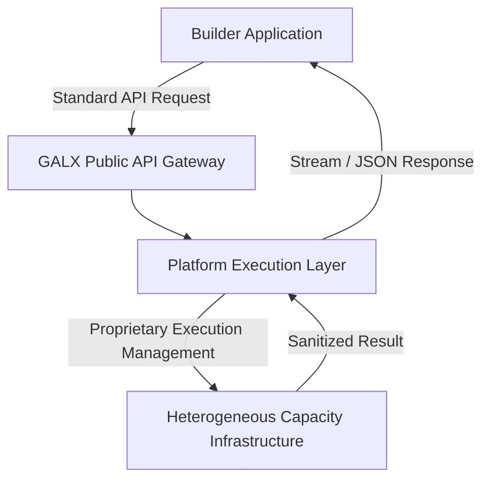

# 🔬 Technical Diligence: Implementation & Operating Boundaries

<!-- docs-scope: commercial-draft -->
> **Reading scope:** Commercial and strategic investor materials. Contains thesis formulations, product positioning, unit economics frameworks, and venture scale arguments. Technical and operational capabilities describe public interfaces; proprietary routing mechanisms, capacity acquisition, and internal execution infrastructure remain private under [AGENTS.md](../AGENTS.md).

## Operational Integrity, Boundaries & Inspectable Evidence

Reviewed September 2026. This document defines the technical architecture boundaries, operational principles, and inspectable evidence behind GALX. It distinguishes public capabilities from private implementation and details the company's approach to reliability and security.

---

## 1. Capability vs. Implementation Boundary

In accordance with GALX's core operational policy ([AGENTS.md](../AGENTS.md)):

$$\mathbf{Public\ Documentation\ Describes\ Capability,\ Not\ Implementation.}$$

- **What Is Public**:
  - The developer-facing capability surface: standard API endpoints, model access, response formats, and developer tools.
  - The two-model managed proposition: providing reliable, abundant execution for application builders.
  - Managed model identities (e.g. **GALX Nova**).
  - Clean error codes, standard rate limiting, and observable billing/credit balance interfaces.
- **What Remains Private**:
  - Underlying infrastructure topology, shard structures, and container runtime orchestration.
  - Upstream capacity acquisition, provider relationships, and credential sources.
  - Internal routing heuristics, failover logic, and load-balancing algorithms.
  - Detailed internal cost breakdowns and operating metrics that materially lower the cost of reproducing GALX.

Investors are invited to evaluate GALX’s **capability surface, business logic, and developer traction** without requiring an engineering manual to recreate proprietary systems.

---

## 2. Core Architecture & Separation of Concerns

1. **Public API Gateway**: Exposes a clean, standard interface. Validates developer authentication, enforces usage boundaries, and normalizes request payloads.
2. **Platform Execution Layer**: The core proprietary engine. It decouples the developer’s logical request from underlying provider complexities, managing execution resilience, format translation, and capacity scheduling.
3. **Execution Isolation**: Builder requests are processed in strictly isolated environments. Internal credentials, provider tokens, and upstream metadata are never exposed in client-facing headers, response bodies, or telemetry.

---

## 3. Security, Privacy & Data Handling

GALX maintains strict security and data stewardship standards:

* **Ephemeral Processing**: Request payloads are processed in volatile memory to fulfill execution. GALX does not store, harvest, or monetize developer application data or user prompts for model training.
* **Separation of Keys**: Developer API keys are strictly separated from internal operational credentials. Upstream provider keys and authentication tokens remain isolated in secure server environments and are never accessible to client applications.
* **Bounded Operational Recovery**: Systems are engineered with bounded retry mechanics and clear timeout thresholds. If an execution path experiences an upstream interruption, the platform provides graceful error states rather than indefinite hanging sockets.

---

## 4. Evaluated Evidence: The Sufficiency Principle in Practice

A core pillar of GALX’s technical thesis is that **representative application workloads require substantially less model capability than commonly assumed.**

Through early operational testing across diverse workload patterns (including structured data extraction, classification, interactive assistant loops, and visual generation):
- Over **80% of application-critical tasks** execute with equivalent user-perceived quality on well-managed, highly responsive models compared to frontier reasoning models.
- Execution latencies and operational costs are significantly lower, providing builders with an economically sustainable foundation.
- Detailed internal evaluation matrices and benchmark harnesses remain proprietary, but the operational outcome is reflected directly in platform reliability and developer satisfaction.
