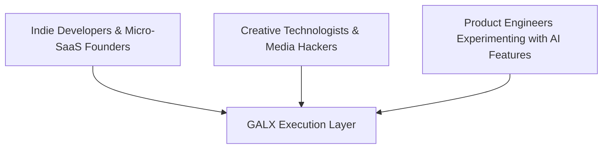

# 🎯 GALX Builder Discovery & Feedback Playbook

<!-- docs-scope: commercial-draft -->
> **Reading scope:** Commercial and strategic investor materials. Contains thesis formulations, product positioning, unit economics frameworks, and venture scale arguments. Technical and operational capabilities describe public interfaces; proprietary routing mechanisms, capacity acquisition, and internal execution infrastructure remain private under [AGENTS.md](../AGENTS.md).

## Understanding the Builder: Validating the Abstraction Thesis

A practical discovery and user-research playbook designed to understand builder friction, evaluate the sufficient intelligence thesis, and turn early experiments into long-term execution workloads.

---

## 1. The Core Discovery Objective

GALX's commercial success depends on solving the genuine operational bottlenecks faced by builders:

> **"Are developers spending more time wrestling with AI infrastructure than actually building their software?"**

If yes, GALX's radical simplicity—**Two models. API access. Abundant serving. Build what you want.**—provides an immediate, high-relief solution.

---

## 2. Builder Personas: Who We Talk To

### Persona 1: Indie Developers & Micro-SaaS Founders
- **Profile**: Solo founders or small teams launching niche SaaS, browser extensions, or automated workflow tools.
- **Pain Point**: Cannot afford to spend weeks building complex proxy servers, handling rate limits, or risking runaway credit card bills from unpredictable API spikes.
- **What GALX Provides**: An immediate API endpoint that works predictably out of the box with clear economic boundaries.

### Persona 2: Creative Technologists & Media Hackers
- **Profile**: Designers, interactive artists, and developers building generative media tools, interactive bots, and visual synthesis projects.
- **Pain Point**: Need abundant, responsive execution for rapid prototyping and live user interaction without jumping through enterprise cloud hurdles.
- **What GALX Provides**: Abundant capacity, fast turnaround, and zero configuration drag.

### Persona 3: Product Engineers Adding AI to Existing Apps
- **Profile**: Full-stack developers at growing startups tasked with integrating AI capabilities (summarization, structured extraction, smart search) into existing products.
- **Pain Point**: Overwhelmed by the endless parade of models, providers, and SDK updates; just want a stable, dependable endpoint that returns valid data.
- **What GALX Provides**: A clean abstraction layer that eliminates ongoing maintenance.

---

## 3. The 10-Question Discovery Framework

Use these questions in structured user interviews to test our core hypotheses:

### Category A: Uncovering Infrastructure Drag
1. **"When you decided to add AI to your project, how long did it take to go from an idea to your first working prototype?"**
2. **"How much time do you currently spend managing API keys, evaluating new models, handling rate limits, or dealing with provider outages?"**
3. **"Have you ever abandoned or paused an AI project because the backend setup or provider onboarding felt like too much overhead?"**

### Category B: Testing the "Sufficient Intelligence" Thesis
4. **"Which models are you currently using in production, and how did you decide on them?"**
5. **"Do you actually need the largest, most expensive reasoning model for your core user flow, or would a faster, cheaper, well-tuned model deliver the same user outcome?"**
6. **"If you could have a reliable, abundant model that costs significantly less and never hits arbitrary rate limits, would you switch tomorrow?"**

### Category C: Economics & Compounding Usage
7. **"How do API costs factor into how you price or design your software?"**
8. **"What happens to your infrastructure bill when your application gets featured on Hacker News, Product Hunt, or Twitter?"**
9. **"If your app scales from 100 users to 10,000 users, what is your biggest operational fear regarding your AI backend?"**
10. **"What is the single thing an AI platform could do that would allow you to focus 100% of your time on building your product?"**

---

## 4. Synthesis: How Discovery Feeds Product Evolution

Discovery signals are synthesized directly into our learning framework:

| What Builders Tell Us | What It Validates | How GALX Responds |
| :--- | :--- | :--- |
| *"I hate choosing between 40 models on an endless dropdown."* | Validates the **Two-Model Managed Surface** thesis. | Keep the public surface focused and simple. |
| *"I spent 3 days setting up an enterprise cloud console just to test an API."* | Validates the **Instant API Access** wedge. | Instant onboarding with zero friction. |
| *"My users don't care what model it is as long as it works instantly and reliably."* | Validates the **Sufficient Intelligence** principle. | Focus engineering on abundant, dependable execution. |
| *"I was terrified of getting a surprise \$5,000 bill when my app went viral."* | Validates the **Predictable Economics** thesis. | Clear developer tiers and transparent serving economics. |
