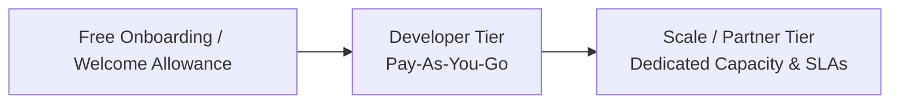

# 🤝 Developer & Partner Access Framework

<!-- docs-scope: commercial-draft -->
> **Reading scope:** Commercial and strategic investor materials. Contains thesis formulations, product positioning, unit economics frameworks, and venture scale arguments. Technical and operational capabilities describe public interfaces; proprietary routing mechanisms, capacity acquisition, and internal execution infrastructure remain private under [AGENTS.md](../AGENTS.md).

## Commercial Terms, Service Expectations & Partner Engagement

A straightforward framework outlining how developers, early design partners, and scaling applications engage with GALX, test platform execution, and transition into production usage.

---

## 1. Engagement Philosophy: Frictionless Developer Access

GALX believes that great developer infrastructure spreads through immediate utility rather than enterprise friction.

- **Instant Onboarding**: Developers can obtain API credentials, test endpoints, and integrate execution into their codebases in minutes.
- **Transparent Usage**: Clear credit allocations and usage tracking eliminate surprise bills.
- **Design Partner Collaboration**: For high-velocity teams building ambitious AI-powered applications, GALX provides direct engineering channels to support custom integration needs and gather operational feedback.

---

## 2. Developer Tiers & Commercial Access

### 1. Developer Preview / Welcome Allowance
- **Purpose**: Immediate experimentation for new builders.
- **Includes**: Starter execution credits to build and validate prototypes.
- **Commitment**: Zero payment required; test the API and explore capability immediately.

### 2. Standard Developer Tier
- **Purpose**: Independent developers, creative technologists, and live applications.
- **Pricing**: Predictable, usage-based consumption.
- **Features**: Full access to the two-model managed surface (including **GALX Nova**), standard API endpoints, and community support.

### 3. Scale & Design Partner Program
- **Purpose**: High-growth applications with substantial recurring execution volume.
- **Features**:
  - Reserved serving capacity to accommodate high-concurrency traffic spikes.
  - Dedicated communication channels with GALX engineering.
  - Collaborative workload optimization to ensure maximum cost-effectiveness and reliability.

---

## 3. Data Privacy & Operational Commitments

GALX maintains clear commitments regarding customer data:

1. **No Data Monetization**: Developer prompts and generation outputs are never sold, harvested, or used for third-party model training.
2. **Ephemeral Memory Processing**: Payloads are processed in volatile memory for the explicit purpose of fulfilling the requested execution.
3. **Availability & Resilience**: GALX continuously monitors platform health to provide high availability across all managed models.

---

## 4. Getting Started

To explore developer access, join the design partner cohort, or discuss scaling an application on GALX:

- **Platform**: [https://galx.ai](https://galx.ai)
- **Documentation**: [https://galx.ai/docs](https://galx.ai/docs)
- **Direct Founder Channel**: `willcruzanswers@gmail.com`
