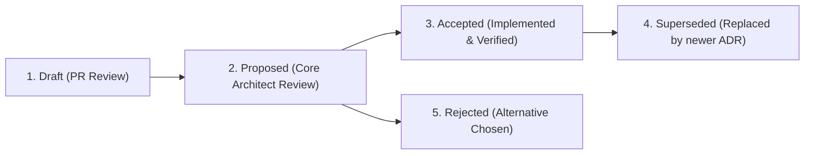

# 🏛️ Architecture Decision Record (ADR) Maintainer Lifecycle & Authoring Guide

> **Target Audience**: Core Maintainers, Subsystem Leads, and System Architects.  
> **Standard**: Follows MADR (Markdown Architectural Decision Records) specification adapted for high-throughput AI gateways and representation transformation substrates.

---

## 1. When is an ADR Mandatory?

An Architecture Decision Record (ADR) is **mandatory** whenever a proposed change:

1. **Introduces a new public API route or headers** (e.g. `x-galx-compact`, `x-galx-compaction-mode`).
2. **Adds a new representation compaction mode** to `BroccoliCompactionFacade` (e.g. `ebpf_stream`, `arrow_dict_stream`).
3. **Modifies routing or capacity algorithms** (P-AHT hydraulic scoring exponents, SWRR selection weights, circuit breaker state machine transitions).
4. **Alters cryptographic or identity mechanisms** (AES-256-GCM AAD parameters, HKDF key derivation info tags, OAuth 2.1 token rotation lifetimes).
5. **Introduces PostgreSQL schema changes** (new tables, RLS policies, foreign keys, or expand/contract migration procedures).
6. **Changes benchmarking methodologies or empirical evaluation protocols** (like the blinded A/B test suite in ADR 0064/0065).

---

## 2. The 5-Stage ADR Lifecycle



| Status | Meaning |
| :--- | :--- |
| **`Draft`** | The decision is under active development and open for feedback. |
| **`Proposed`** | The author has finalized the specification; ready for Core Architect review. |
| **`Accepted`** | Consensus reached; the change is implemented and guarded by automated tests. |
| **`Superseded`** | A newer ADR replaces this decision (must link to the successor ADR). |
| **`Rejected`** | The proposal was evaluated but declined (rationale recorded for future context). |

---

## 3. The Standard ADR Template

Create new ADR files in `docs/adr/NNNN-slug-title.md` where `NNNN` is a zero-padded 4-digit sequential integer (e.g., `0066-dicom-medical-imaging-stream-compactor.md`).

```markdown
# ADR NNNN: [Descriptive Decision Title]

## Metadata
* **Status**: [Draft | Proposed | Accepted | Superseded by ADR XXXX]
* **Date**: YYYY-MM-DD
* **Authors**: @username
* **Subsystem**: [src/core/broccolidb | src/core/vault | src/core/router | supabase/migrations]
* **Impact**: [Breaking | Additive | Optimization | Security Hardening]

---

## 1. Context & Problem Statement
[Describe the engineering challenge, latency bottleneck, or token redundancy being addressed. Include raw data examples or metrics.]

---

## 2. Decision Drivers
* Driver 1 (e.g. a measured request deadline and bounded retry budget)
* Driver 2 (e.g. 100% fail-closed anti-hallucination guarantee)
* Driver 3 (e.g. Zero-copy SSE memory efficiency)

---

## 3. Considered Options
1. **Option A**: [Description of Option A]
2. **Option B (Chosen)**: [Description of Option B]
3. **Option C**: [Description of Option C]

---

## 4. Decision & Implementation Details
[Detailed technical specification of the chosen architecture. Include TypeScript interfaces, regex patterns, or mathematical calculus equations.]

---

## 5. Invariant & Safety Guarantees
* **Grounding Invariant**: [How BroccoliCompactionSafety or AAD ensures safety]
* **Memory Bound**: [Payload bounds, TypedArray slot sizes, spillover file limits]
* **Zero Downtime**: [How rolling updates or expand-contract migrations proceed]

---

## 6. Verification & Test Suite
List the automated commands required to verify this decision:
```bash
npm run test:broccolidb:api
npm run bench:inference-boundary
npx tsc --noEmit
```

---

## 7. Consequences & Trade-offs
### Positive:
* Token savings of X% across targeted workloads.
* Sub-5ms in-process execution.

### Negative / Trade-offs:
* Additional memory buffer overhead (~64KB per active channel).
```

---

## 4. Maintainer Review Checklist for ADRs

Before marking an ADR as **`Accepted`**, the reviewing Core Architect must confirm:
- [ ] The problem statement is concrete with measurable baseline data.
- [ ] At least 2 alternatives were considered with trade-offs articulated.
- [ ] Safety, memory bounds, and fail-closed behaviors are explicitly addressed.
- [ ] An automated test suite backs the implementation.
- [ ] The ADR is indexed in [`docs/adr/README.md`](../adr/README.md) and [`docs/ARCHITECTURE.md`](../ARCHITECTURE.md).

---

*For the complete index of accepted decisions, see [Architecture Decision Records (0001–0065)](../adr/README.md).* 🥦🏛️

## Runtime truth and supersession

When a decision changes runtime behavior, update the affected deployment runbook, API reference, security guide, troubleshooting guide, and catalogs in the same change. Remove obsolete commands and unsupported guarantees from active instructions; source control retains their history. State which component implements the decision, which paths remain separate, what was actually verified, and when.

For relay changes, ADR 0122 and the relay runbook are the current baseline. Do not transfer platform database-lease guarantees, experimental scheduler results, or application billing behavior into the standalone relay contract. Preserve downstream tool-use capability while documenting that the relay grants no local tool execution authority.
