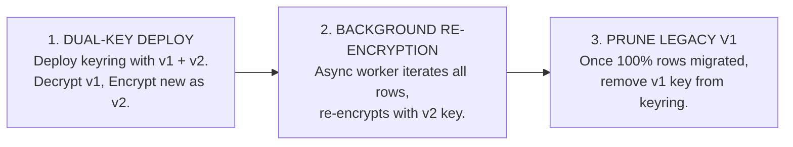

# 🔐 Maintainer Runbook: Multi-Tenant Shards & Master Key Rotation

> **Target Audience**: Security Engineers, Platform Architects, and Shard Fleet Maintainers.  
> **Subsystems**: `src/core/vault/GalxCryptoVault.ts`, `src/core/pool/GalxCredentialPool.ts`, `supabase/migrations/`.

---

## 1. Provider Shard Fleet Architecture

GALXAI routes enterprise requests across pooled upstream model provider accounts (Tier-5 OpenAI / xAI organizations):

```text
┌─────────────────────────────────────────────────────────────────────────────┐
│                           MULTI-TENANT SHARD POOLING                        │
├─────────────────┬───────────────────┬───────────────────┬───────────────────┤
│ Shard Alpha     │ Shard Beta        │ Shard Gamma       │ Shard Delta       │
│ (Tier-5 OpenAI) │ (Tier-5 OpenAI)   │ (xAI Grok Fleet)  │ (Tier-5 Fallback) │
├─────────────────┼───────────────────┼───────────────────┼───────────────────┤
│ TPM: 30,000,000 │ TPM: 30,000,000   │ TPM: 15,000,000   │ TPM: 30,000,000   │
│ AAD: tenant_01  │ AAD: tenant_02    │ AAD: tenant_01    │ AAD: multi_pool   │
└─────────────────┴───────────────────┴───────────────────┴───────────────────┘
```

---

## 2. Zero-Downtime 3-Phase Master Vault Key Rotation

When rotating the master encryption secret (`GALX_VAULT_MASTER_SECRET`) from version `v1` to `v2`:



### Step-by-Step Key Rotation Execution:

1. **Update Master Keyring in `GalxCryptoVault.ts`**:
   Add the new derived key `v2` to the versioned keyring:
   ```typescript
   export const PRIMARY_KEY_VERSION = 'v2';
   const KEYRING: Map<string, Buffer> = new Map([
     ['v1', deriveVersionedKey(OLD_MASTER_SEED, 'v1')],
     ['v2', deriveVersionedKey(NEW_MASTER_SEED, 'v2')]
   ]);
   ```

2. **Execute Background Re-Encryption Migration**:
   ```bash
   npx tsx scripts/reencrypt-vault-shards.ts --from-version=v1 --to-version=v2
   ```

3. **Verify Zero Remaining V1 Shards**:
   ```sql
   SELECT count(*) FROM galx_provider_shards WHERE key_version = 'v1';
   -- Must return 0
   ```

4. **Prune V1 from Keyring & Deploy**:
   Remove `v1` from `KEYRING` and deploy to production.

---

## 3. Shard Fleet Health & Rebalancing

Maintainers can inspect the real-time hydraulic headroom of the shard fleet:

```bash
npm run playbook -- --stage=traffic
```

If a shard is marked `DEGRADED` due to sustained upstream provider timeouts:
1. `GalxCircuitBreaker` will automatically shed traffic away from the degraded shard.
2. The hydraulic router routes subsequent requests to healthy peer shards with available reservation headroom.

---

*Preserve cryptographic isolation at all times.* 🥦🔐🛡️
