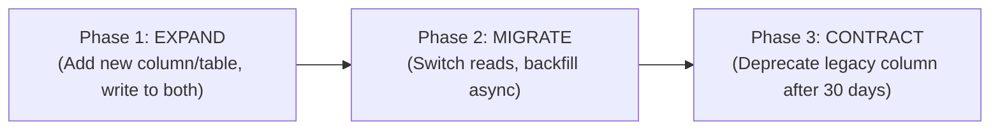

# 🗄️ Maintainer Runbook: PostgreSQL Migrations & AOP-DB Protocol

> **Target Audience**: AI Database Operators, SREs, and Database Maintainers.  
> **Core Law**: *"Zero destructive DDL without 3-Phase Expand/Contract Protocol. Default-deny RLS on 100% of tables."*

---

## 1. The 3-Phase Expand/Contract Protocol

When introducing schema changes to Supabase PostgreSQL:



---

## 2. File Naming & Migration Structure

Every database change MUST produce two atomic, idempotent files:
1. `supabase/migrations/YYYYMMDDHHMMSS_action_name.up.sql` (Forward migration)
2. `supabase/migrations/YYYYMMDDHHMMSS_action_name.down.sql` (Reversible rollback)

---

## 3. Zero-Lock DDL Rules

### ❌ Forbidden Patterns:
```sql
-- DANGEROUS: Locks entire table against writes
CREATE INDEX idx_orders_user_id ON orders(user_id);
ALTER TABLE users ADD COLUMN bio text NOT NULL DEFAULT '';
DROP TABLE legacy_records;
```

### ✅ Mandatory Zero-Lock Patterns:
```sql
-- SAFE: Zero-lock concurrent index creation
CREATE INDEX CONCURRENTLY IF NOT EXISTS idx_orders_user_id ON orders(user_id);

-- SAFE: Nullable column addition + asynchronous backfill
ALTER TABLE users ADD COLUMN IF NOT EXISTS bio text;

-- SAFE: Foreign key with NOT VALID constraint + concurrent validation
ALTER TABLE orders 
  ADD CONSTRAINT fk_orders_user 
  FOREIGN KEY (user_id) REFERENCES users(id) 
  NOT VALID;

ALTER TABLE orders VALIDATE CONSTRAINT fk_orders_user;
```

---

## 4. Default-Deny RLS Policy Template

Every new table created in `public` must execute:

```sql
-- 1. Enable and Force RLS
ALTER TABLE public.my_new_table ENABLE ROW LEVEL SECURITY;
ALTER TABLE public.my_new_table FORCE ROW LEVEL SECURITY;

-- 2. Scoped Service Role Policy (Internal gateway execution)
CREATE POLICY "service_role_full_access" 
  ON public.my_new_table 
  FOR ALL 
  TO service_role 
  USING (true) 
  WITH CHECK (true);

-- 3. Tenant Isolation Policy (Authenticated users only see own tenant rows)
CREATE POLICY "tenant_isolated_access" 
  ON public.my_new_table 
  FOR ALL 
  TO authenticated 
  USING (tenant_uid = auth.uid()) 
  WITH CHECK (tenant_uid = auth.uid());
```

---

## 5. `SECURITY DEFINER` Search Path Sanitization

Any RPC stored procedure with `SECURITY DEFINER` MUST explicitly pin its search path:

```sql
CREATE OR REPLACE FUNCTION public.fn_secure_wallet_operation(p_tenant_uid text)
RETURNS jsonb
LANGUAGE plpgsql
SECURITY DEFINER
SET search_path = public, pg_temp
AS $$
BEGIN
  -- Safe logic here
END;
$$;
```

---

## 6. Migration Verification Checklist

Before applying any migration to staging or production:
1. [ ] Run `npm run db:verify` to execute the automated paranoia linter.
2. [ ] Test the rollback script: Apply `.up.sql`, then apply `.down.sql`, and verify zero residue.
3. [ ] Verify that TypeScript types in `src/core/contracts/` stay in lockstep.

---

*For full database architecture, see [SUPABASE_PARANOID_ARCHITECTURE_SPEC.md](../SUPABASE_PARANOID_ARCHITECTURE_SPEC.md).* 🥦🗄️🛡️
