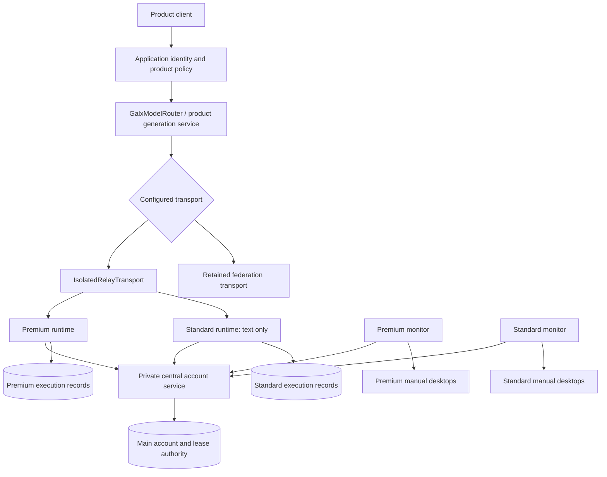

# Subsystem ownership and dependencies

<!-- docs-scope: domain-reference -->

Private source-navigation reference. [Architecture](../ARCHITECTURE.md) owns the system contract; [current state](../../post-mortem/CURRENT_STATE.md) owns deployment evidence. Component presence in source is not evidence that every deployment invokes it.

## 1. Top-Level Architectural Dependency DAG

The mode branch is deliberate server configuration, not failure fallback. Text stays in its selected pool; Sites/images use Premium. Pools cannot query or borrow the peer. Isolated dispatch bypasses application account selection/decryption and a duplicate account lease; runtime admission uses the existing central ledger. Product quota and shared Sites fair usage remain separate.

Premium and Standard occupy separate local VMs/daemons/disks; central HTTPS runs on Docker Desktop. Engines run in-process per account inside each runtime container. Only each monitor has its own VM's Docker socket for desktops. The shared physical Mac/admin remains trusted. The public deployment still retains the legacy path until a separately qualified cutover.

The configured Cloudflare Worker has an independent entrypoint/bindings and is not automatically a hop before the application. R2 storage, native hosting and gateway deployment retain separate contracts. See [Cloudflare boundaries](../CLOUDFLARE_STRATEGY.md).

## 2. Memory & Buffer Allocation Invariants

Read each owning implementation for actual bounds; do not infer them from an architecture diagram or benchmark. Process-local caches, rate observations and compaction representations cannot replace database identity, account grants, quota decisions or durable receipts.

| Subsystem | Owning reference | Boundary |
| --- | --- | --- |
| Central lifecycle and execution | [Account management](../reference/relay-account-management.md) | Revision/epoch checks, central leases, durable operation identity, no uncertain redispatch |
| Image requests/assets | [Image recovery](../../post-mortem/runbooks/image-generation.md), [library scale](image-library-scale.md) | Owner-scoped durable acknowledgment; bounded metadata/write buffers |
| Sites generation | [Sites operations](SITES_OPERATIONS.md) | Customer admission, original outcome and publication are separate |
| BroccoliDB/compaction | [Component guide](../BROCCOLIDB_COMPACTION_ONBOARDING_GUIDE.md), [domain index](../broccolidb/README.md) | Representation/performance evidence does not grant authorization or prove universal fidelity |
| Account sessions | [Workspace authentication](../operations/workspace-auth.md) | Server-verified identity and current authoritative session checks |
| Telemetry | [Metrics reference](TELEMETRY_AND_METRICS_OBSERVABILITY.md) | Bounded observations with units/freshness, not billing or health authority |

## 3. Subsystem Lifecycle & Finite State Machines

New pool account state is centrally saved; fresh matching runtime acknowledgment is separate. Registration is manual and paused initially. Remove permanently revokes registered accounts with retained evidence; unfinished registrations may restore with new review. Pause stops engines/grant renewal and does not use the legacy hold semantics.

Execution reservation precedes central lease binding and provider I/O. Failed grant renewal aborts work; unconfirmed terminal writes stop new local admission. Old incomplete rows recover unknown after restart. Circuit-breaker or retry utilities cannot override those outcomes or select a peer pool. Use [resilience](../RESILIENCE_AND_DISASTER_RECOVERY.md), not an illustrative generic state machine, for recovery.

## 4. Barrel Export Hygiene & Boundary Rules

Keep private operational modules, docs, credentials, execution identifiers and diagnostics out of customer bundles and DTOs. Public field allowlists and re-encoded image artifacts are required; importing an internal object wholesale is not a response contract.

Use the owning BroccoliDB public facade and [contribution guidance](../../CONTRIBUTING.md) rather than exporting generated implementation modules by convenience. Inspect actual dependency/runtime constraints before moving code between Node, browser and Worker entrypoints.

Product scope includes current Images/Sites workspaces under their own access/ownership rules; historical claims that all hosted composition is retired are not current guidance. [Product strategy](../PRODUCT_SURFACE_STRATEGY.md) and [workspace authentication](../operations/workspace-auth.md) own route and return-path behavior.

Use [debugging procedures](DEBUGGING_AND_DIAGNOSTIC_RUNBOOKS.md) for incidents and [documentation workflow](../how-to/change-with-documentation.md) for changes. Fixed historical migration counts, memory latencies and unsupported global topology claims have been removed from this reference.
