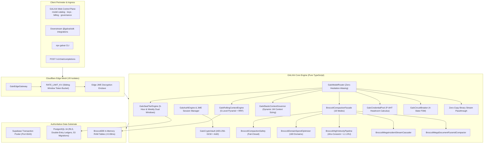

# 🏛️ Subsystem Internals & Dependency DAG

> **Target Audience**: Core Maintainers, Performance Engineers, and Security Architects.  
> **Purpose**: Formal specification of internal module dependencies, memory limits, and runtime dataflows across Serverless and Cloudflare Edge runtimes.

---

## 1. Top-Level Architectural Dependency DAG



---

## 2. Memory & Buffer Allocation Invariants

| Subsystem | Memory Allocation Model | Hard Cap / Boundary | Failure Behavior |
| :--- | :--- | :--- | :--- |
| **`BroccoliCompactionFacade`** | Contiguous typed arrays (`Uint8Array`) | 2,000,000 characters (~2MB) / payload | `RangeError: String length exceeds limit` |
| **`BroccoliRingBufferStreamPool`** | Pre-allocated 64KB TypedArray slots | 32MB Volatile RAM slab | Spills to `.data/spillover/` private files |
| **`GalxCryptoVault`** | Ephemeral `Buffer.alloc` with deterministic 2-pass zeroization | Scoped to active function execution | `zeroizeBuffer` runs unconditionally in `finally` |
| **`BroccoliHighVelocityPipeline`** | L1 LRU in-memory hash cache | 10,000 entries (sliding-window eviction) | Evicts oldest entries on watermark breach |
| **`RATE_LIMIT_KV`** | Cloudflare Edge KV V8 memory store | 100-event sliding window / key | Fails open on transient edge KV degradation |

---

## 3. Subsystem Lifecycle & Finite State Machines

### The 4-State Circuit Breaker State Machine (`GalxCircuitBreaker`):
```text
  ┌────────────────────────────────────────────────────────┐
  ▼                                                        │
┌───────────┐   3 Consecutive Timeouts / 5xx  ┌────────────┐   Canary Probe Pass (3/3)
│  CLOSED   │ ──────────────────────────────► │  DEGRADED  │ ──────────────────────┘
└───────────┘                                 └────────────┘
      ▲                                             │
      │                                             ▼ Sustained Error Wave (>15%)
┌───────────┐                                 ┌────────────┐
│ HALF-OPEN │ ◄────────────────────────────── │    OPEN    │
└───────────┘        Cooldown Window Expired  └────────────┘
```

---

## 4. Barrel Export Hygiene & Boundary Rules

To prevent ungrounded bypass bugs and accidental leakages of generated compactors:
1. **Rule 1**: Public code MUST import from `@/core/broccolidb` (which exports `BroccoliCompactionFacade` and `BroccoliCompactionSafety`).
2. **Rule 2**: Individual generated domain compactors (`BroccoliInterrogatoryCompactor`, `BroccoliPathologyCompactor`, etc.) are **private internal implementation details**. Never export them from the master barrel.
3. **Rule 3**: `src/core/` must NEVER import React, Next.js routing, or browser DOM types.
4. **Rule 4**: GALXAI-hosted UI stops at discovery, configuration, metering, and governance. Chat and image-generation composers belong to downstream applications; compatible inference APIs and SDK contracts remain platform scope.
5. **Rule 5**: Default authentication completion resolves to `/models`. Explicit protected-route return paths may override it, but no auth flow may default to a retired client surface.

---

*For maintainer debugging runbooks, see [DEBUGGING_AND_DIAGNOSTIC_RUNBOOKS.md](DEBUGGING_AND_DIAGNOSTIC_RUNBOOKS.md).* 🥦🛡️
