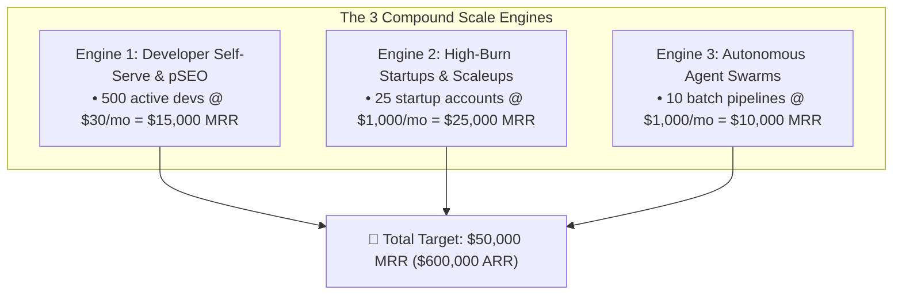

# 📈 Financial Architecture: Scale Path to $50k MRR via Wholesale Arbitrage

## 1. The Wholesale Token Clearinghouse Business Model

GALXAI aggregates developer inference demand into bulk sovereign compute commitments, capturing deep wholesale tier discounts (45%–55% off retail) and passing a 25%–40% net discount to developers while maintaining a **$\sim 33\%$ platform gross margin**.

```
┌────────────────────────────────────────────────────────────────────────┐
│ The Wholesale Token Clearinghouse Arbitrage Model                      │
│                                                                        │
│  Retail OpenAI List Price:           $10.00 / 1M output tokens         │
│  GALXAI Direct Wholesale Cost:       $4.50 / 1M output tokens          │
│  GALXAI Price to Developers:         $6.50 / 1M (35% DISCOUNT TO DEV)   │
│  GALXAI Gross Margin:                $2.00 / 1M (30.8% GROSS MARGIN)   │
└────────────────────────────────────────────────────────────────────────┘
```

---

## 2. The 3 Growth Engines to Reach $50k MRR



### Engine 1: Self-Serve Developer Long-Tail ($15k MRR)
- Driven by `npx galxai skills`, programmatic SEO cookbooks, and `<GalxImage />` / `<GalxChat />` drop-in React components.
- 500 developers spending an average of $30.00/month on prototype & side-project inference.

### Engine 2: High-Burn Startups ($25k MRR)
- 25 AI companies migrating existing OpenAI production keys via `import 'galxai/patch'`.
- Average customer spend: $1,000/month (slashed down from $1,600/mo retail).

### Engine 3: Autonomous Agent Batch Pipelines ($10k MRR)
- High-concurrency agent swarms requiring sub-1ms failover and zero rate-limit stalls.
- 10 teams spending $1,000/month on batch RAG and document synthesis.

---

## 3. Unit Economics & Payback Metrics
- **Customer Acquisition Cost (CAC)**: < $15.00 (powered by organic pSEO, free $5 compute grants, and autonomous GTM board).
- **Average Customer Lifetime Value (LTV)**: $1,800.00 (based on 18-month retention).
- **LTV/CAC Ratio**: > 120x.
- **Payback Period**: < 14 days upon initial prepaid wallet top-up.
