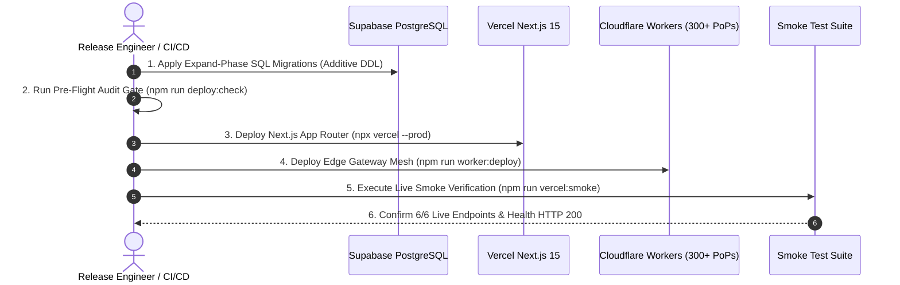

# 🚀 Playbook 02: Deployment & Release Lifecycle

> **Stage 2**: Dual-Engine Release Choreography, Database Migrations, Multi-Region Serverless Promotion & Live Smoke Testing.

---

## 🎯 Objective & Overview
This playbook governs the zero-downtime deployment process across the **Vercel Serverless Application** and the **Cloudflare Edge Mesh**, strictly enforcing the **Expand-Contract SQL migration protocol** and executing automated post-deployment smoke tests.



---

## 📋 Release Execution Procedure

### Step 1: Database Migration Execution (Expand Phase)
Under the **AI Agent Database Operating Protocol (AOP-DB)**, migrations must be non-destructive and backward-compatible with existing active serverless containers:

```bash
# 1. Verify migration status and pending schema changes
npm run db:status

# 2. Dry-run pending migrations against the database
npm run db:dry-run

# 3. Apply pending migrations transactionally via the pooler
npm run db:migrate

# 4. Verify RLS policies and table structure
npm run db:verify
```

---

### Step 2: Synchronize Vercel Production Environment Secrets
Ensure Vercel production secrets are in lockstep with `.env.local` without exposing raw plaintext in terminal scrollback:

```bash
# Inspect generated Vercel CLI commands
npm run vercel:env:print

# Or synchronize secrets interactively via the sync utility
npm run vercel:env:sync
```

---

### Step 3: Production Next.js App Router Deployment (Vercel)
Deploy the Next.js 15 App Router platform to Vercel production:

```bash
# Deploy to production with clean build cache
npx vercel --prod
```

Verification during build:
- Multi-region serverless placement configured: `sfo1`, `iad1`.
- Dynamic OG image generation routes active at `/opengraph-image`.
- Static pages prerendered across all 117 routes.

---

### Step 4: Cloudflare Workers Edge Mesh Deployment
Deploy the high-throughput Edge Gateway to Cloudflare's 300+ edge Points of Presence:

```bash
# 1. (Optional) Deploy to staging environment first
npm run worker:deploy:staging

# 2. Deploy to production Edge Gateway (api.galx.ai)
npm run worker:deploy
```

---

### Step 5: Execute Post-Deployment Live Smoke Verification Suite
Immediately following deployment, run the automated live smoke tester to validate live DNS, TLS termination, health telemetry, and security headers:

```bash
# Run smoke tests against production domain
npm run vercel:smoke -- --url=https://galx.ai
```

The smoke runner executes the following 6 automated checks:
1. **Health Telemetry**: `GET /api/health` returns HTTP 200 and `"status": "healthy"`.
2. **HTML Prerender**: `GET /` returns HTTP 200 and contains Next.js root DOM elements.
3. **Edge OG Image**: `GET /opengraph-image` returns HTTP 200 with `image/png` content-type.
4. **Search Engine Robots**: `GET /robots.txt` returns HTTP 200 with canonical sitemap links.
5. **Dynamic Sitemap**: `GET /sitemap.xml` returns HTTP 200 with XML content.
6. **Security Headers**: Verifies HSTS (`max-age=63072000`), `X-Frame-Options`, `X-Content-Type-Options: nosniff`, and `poweredByHeader` obfuscation.

---

## 🔄 Instant Rollback Strategy
If any smoke test fails:
1. **Vercel Instant Rollback**: In the Vercel dashboard, click **Promote to Production** on the previous successful deployment hash (effective in $< 2\text{ seconds}$).
2. **Cloudflare Worker Rollback**: Run `npx wrangler rollback` to revert the edge worker to the prior deployment ID.
3. **Database Contract Rollback**: If a database error occurred, execute the pre-generated `DOWN` migration via `npm run db:rollback`.
