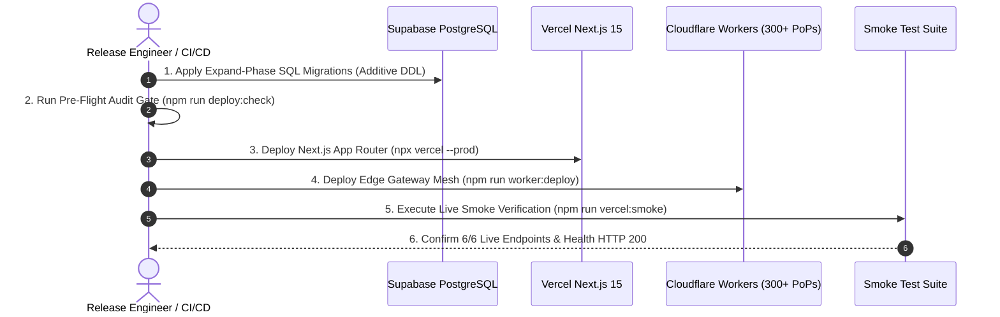

# 🚀 Playbook 02: Deployment & Release Lifecycle

> **Stage 2**: Dual-Engine Release Choreography, Database Migrations, Multi-Region Serverless Promotion & Live Smoke Testing.

---

## 🎯 Objective & Overview
This playbook governs the zero-downtime deployment process across the **Vercel Serverless Application** and the **Cloudflare Edge Mesh**, strictly enforcing the **Expand-Contract SQL migration protocol** and executing automated post-deployment smoke tests.



---

## 📋 Release Execution Procedure

### Step 1: Database Migration Execution (Expand Phase)
Under the **AI Agent Database Operating Protocol (AOP-DB)**, migrations must be non-destructive, paired with reversible `.down.sql` scripts, and backward-compatible with active serverless containers:

```bash
# 1. Audit static migration integrity and rollback parity (53 migrations)
npm run db:verify

# 2. Push pending migrations to the Supabase pooler
npm run db:push

# 3. Execute the live database integration suite
npm run db:test
```

---

### Step 2: Synchronize Vercel Production Environment Secrets
Ensure Vercel production secrets are in lockstep with `.env.local` without exposing raw plaintext in terminal scrollback:

```bash
# Inspect generated Vercel CLI commands
npm run vercel:env:print

# Or synchronize secrets interactively via the sync utility
npm run vercel:env:sync
```

---

### Step 3: Production Next.js App Router Deployment (Vercel)
Create and verify a preview before production promotion:

```bash
# Local release gates
npm run test:browser-agent
npm run test:sessions
npm run deploy:check

# Preview deployment and live protocol smoke
npx vercel
npm run vercel:smoke -- --url=https://<preview-deployment>

# Production candidate
npx vercel --prod
```

Verification during build:
- The web client and server routes compile against the same protocol version.
- `GET /api/client/bootstrap` is secret-free and reports the expected deployment.
- Browser agent requests are same-origin, session-explicit, idempotent, and streamed through SSE.
- Interactive inference functions permit up to 300 seconds; longer work is routed to the durable relay rather than extended in-process.
- Security headers are single-sourced in `next.config.ts`; `vercel.json` contains placement only.

In Vercel project settings, enable **Skew Protection**. On Pro or Enterprise, enable Rolling Releases and promote the candidate through `5% → 25% → 50% → 100%`, holding each stage long enough to compare error rate, time-to-first-token, stream interruption rate, and session mismatch rejections. Custom browser fetches attach the bootstrap deployment ID, so the active page remains paired with a compatible route implementation.

### Agent client deployment boundary

```text
Vercel CDN/UI → same-origin Next.js BFF → GALX gateway/relay
                                         ├─ Supabase authority
                                         ├─ authorized work queue
                                         └─ journal event projection
```

The browser may interrupt an SSE connection, but it may not infer that the execution was cancelled. Provider keys must be configured in the server-side shard vault; legacy keys found in browser chat settings are removed during settings normalization. Do not enable durable resume in the bootstrap until the PostgreSQL-backed execution endpoint and journal `Last-Event-ID` stream are deployed together.

---

### Step 4: Cloudflare Workers Edge Mesh Deployment
Deploy the high-throughput Edge Gateway to Cloudflare's 300+ edge Points of Presence:

```bash
# 1. (Optional) Deploy to staging environment first
npm run worker:deploy:staging

# 2. Deploy to production Edge Gateway (api.galx.ai)
npm run worker:deploy
```

---

### Step 5: Execute Post-Deployment Live Smoke Verification Suite
Immediately following deployment, run the automated live smoke tester to validate live DNS, TLS termination, health telemetry, and security headers:

```bash
# Run smoke tests against production domain
npm run vercel:smoke -- --url=https://galx.ai
```

The smoke runner includes the following release-critical checks:
1. **Health Telemetry**: `GET /api/health` returns HTTP 200 and `"status": "healthy"`.
2. **HTML Prerender**: `GET /` returns HTTP 200 and contains Next.js root DOM elements.
3. **Edge OG Image**: `GET /opengraph-image` returns HTTP 200 with `image/png` content-type.
4. **Search Engine Robots**: `GET /robots.txt` returns HTTP 200 with canonical sitemap links.
5. **Dynamic Sitemap**: `GET /sitemap.xml` returns HTTP 200 with XML content.
6. **Security Headers**: Verifies HSTS (`max-age=63072000`), `X-Frame-Options`, `X-Content-Type-Options: nosniff`, and `poweredByHeader` obfuscation.
7. **Agent Bootstrap**: Verifies protocol `2026-09-04`, same-origin SSE, and a secret-free client capability envelope.

---

## 🔄 Instant Rollback Strategy
If any smoke test fails:
1. **Stop the rolling release**: Hold or revert the current candidate if the error, interruption, or session-mismatch budget regresses.
2. **Vercel Instant Rollback**: Promote the previous successful deployment. Skew Protection keeps already-open clients paired with their compatible server version during the transition.
3. **Cloudflare Worker Rollback**: Run `npx wrangler rollback` to revert the edge worker to the prior deployment ID.
4. **Database compatibility**: Prefer forward repair for additive expand-phase migrations. Run a down migration only when its reviewed rollback is safe for both the old and new application versions.
