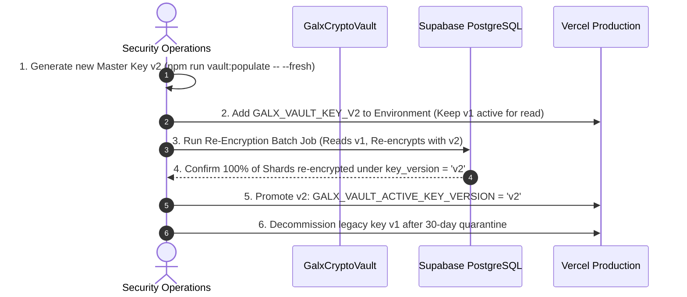

# 🔒 Playbook 05: Security, Zero-Downtime Key Rotation & Compliance Auditing

> **Stage 5**: Vault Master Secret Rotation (v1 $\to$ v2), Re-encryption Migration, SOC 2 Type II Signed Evidence Extraction & GDPR Article 17 Purge Protocols.

---

## 🎯 Objective & Overview
This playbook defines the zero-downtime cryptographic key rotation protocol for `GALX_VAULT_MASTER_SECRET`, procedures for extracting signed SOC 2 Type II auditor evidence packages, and handling GDPR Right-to-Erasure compliance requests.

---

## 🔑 Zero-Downtime Vault Master Secret Rotation (`v1` $\to$ `v2`)

When rotating master encryption secrets, GALXAI uses a **Dual-Key Phased Migration Protocol** to prevent decryption outages:



### Rotation Execution Steps:
```bash
# 1. Generate a new cryptographically secure 256-bit key
npm run vault:populate -- --fresh

# 2. Add the secondary key to Vercel production
vercel env add GALX_VAULT_KEY_V2 production

# 3. Trigger the zero-downtime database re-encryption job
npm run db:reencrypt-vault -- --from=v1 --to=v2

# 4. Set the active key version to v2
vercel env add GALX_VAULT_ACTIVE_KEY_VERSION production # value: v2

# 5. Verify decryption roundtrip across all active shards
npm run vercel:verify
```

---

## 📋 SOC 2 Type II Compliance & Signed Evidence Extraction

For SOC 2 Type II and HIPAA regulatory audits, GALXAI exposes machine-readable evidence endpoints:

### 1. Retrieve Real-Time SOC 2 Posture Scorecard:
```bash
curl -X GET https://api.galx.ai/api/compliance/posture \
  -H "Authorization: Bearer galx_live_..."
```
Returns posture compliance across all 5 Trust Services Criteria (28 controls) with numeric posture grades.

### 2. Export Cryptographically Signed Evidence Package:
```bash
curl -X GET https://api.galx.ai/api/compliance/evidence \
  -H "Authorization: Bearer galx_live_..." \
  -o soc2-evidence-dossier.json
```
The resulting JSON dossier includes:
- **Merkle Audit Root**: Chained SHA-256 root hash of all administrative events.
- **ZDR v10.0 Memory Scrubbing Proof**: Test vectors confirming 2-pass RAM zeroization.
- **Hardware Cipher Verification**: AES-256-GCM self-test logs and HKDF parameters.
- **Digital RSA/ECDSA Signature**: Auditor-verifiable cryptographic signature.

---

## 🛡️ GDPR Article 30 Records of Processing Activities (RoPA)

To generate the authoritative GDPR Article 30 register:
```bash
curl -X GET https://api.galx.ai/api/compliance/ropa \
  -H "Authorization: Bearer galx_live_..." \
  -o gdpr-ropa-register.json
```

---

## 🗑️ GDPR Article 17 Right-to-Erasure / Cryptographic Purge

When a verified Data Subject Access Request (DSAR) or Right-to-Erasure is filed:

```bash
# Execute immediate cryptographic shredding of user sessions, keys, and cache
curl -X POST https://api.galx.ai/api/compliance/dsar/purge \
  -H "Authorization: Bearer galx_live_..." \
  -H "Content-Type: application/json" \
  -d '{"userId": "usr_abc123"}'
```

### Verification of Erasure:
1. All API keys for `userId` are permanently deleted from `public.galx_api_keys`.
2. All encrypted credential shards for `userId` are zeroized in `public.galx_vault_shards`.
3. Cached KV sessions across 300+ Edge PoPs are purged via `RATE_LIMIT_KV`.
4. A signed **Proof of Cryptographic Erasure Certificate** is returned in the HTTP 200 response.
