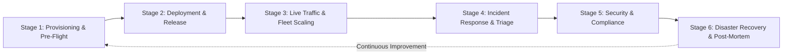

# 📚 GALXAI Operational Lifecycle Playbooks: Master Directory

> **Authoritative Operational Standards & Incident Management Manual**  
> **Target Audience**: Site Reliability Engineers (SREs), Infrastructure Maintainers, Security Operations, Incident Commanders, and Autonomous AI Database Operators.

---

## 🏛️ 1. Lifecycle Architecture & Stage Matrix

GALXAI structures all operational procedures across six distinct lifecycle stages to guarantee zero downtime, sub-15ms edge routing, and strict cryptographic integrity:



| Lifecycle Stage | Playbook Document | Primary Purpose & Scope |
| :--- | :--- | :--- |
| **Stage 1** | [01: Provisioning & Pre-Flight](01-provisioning-and-preflight.md) | Node 20 LTS environment pinning, Vault master secret derivation, Supabase transaction pooler setup, Cloudflare KV/R2 resource initialization, and 8-phase pre-flight audit gates. |
| **Stage 2** | [02: Deployment & Release](02-deployment-and-release.md) | Next.js 15 multi-region serverless deployment (`sfo1`, `iad1`), zero-downtime expand-contract SQL migrations, Cloudflare Workers canary deployment, and live smoke tests. |
| **Stage 3** | [03: Live Traffic & Fleet Scaling](03-live-traffic-and-fleet-scaling.md) | P-AHT hydraulic headroom tuning, continuous calculus token-bucket rate limiter configuration, BYOQ shard rebalancing, SWR model catalog caching, and async pull queue worker leasing. |
| **Stage 4** | [04: Incident Response & Triage](04-incident-response-and-sev-triage.md) | Sev-1 through Sev-4 incident classifications, 4-state circuit breaker failovers, database connection pool exhaustion triage, cryptographic AAD mismatches, and DDoS mitigations. |
| **Stage 5** | [05: Security & Compliance](05-security-key-rotation-and-compliance.md) | Zero-downtime Vault Master Secret rotation (`v1` $\to$ `v2`), SOC 2 Type II signed evidence extraction (`/api/compliance/evidence`), GDPR Article 17 purge, and Merkle audit chain verification. |
| **Stage 6** | [06: Disaster Recovery & Post-Mortems](06-disaster-recovery-and-postmortems.md) | Cloudflare edge PoP evacuation, Supabase Point-in-Time Recovery (PITR), R2 multimodal asset recovery, blameless post-mortem template, and automated regression test authoring. |
| **Stage 7** | [07: Zero-Hesitation DX & API Governance](07-zero-hesitation-developer-ergonomics-and-api-governance.md) | Universal multi-mental-model absorption (OpenAI, Anthropic, Ollama, LangChain, Vercel AI, Midjourney), zero-install CLI operations (`npx galxai`), GET browser execution, and 98-test verification gates. |
| **Stage 8** | [08: Unframed Developer Observation Protocol](08-unframed-developer-observation-protocol.md) | 8-vector behavioral observation protocol for unframed developer trials, induced mental model taxonomy, and qualitative product signal capture. |


---

## 🚨 2. Severity Classification Matrix & SLA Timelines

When an incident occurs, the On-Call Engineer must immediately assign a severity level according to this matrix:

| Severity Level | Definition & Criteria | Target Triage Time | Target Resolution SLA | Primary Escalation Role |
| :--- | :--- | :--- | :--- | :--- |
| **SEV-1 (Critical)** | Core inference outage ($> 10\%$ error rate on `api.galx.ai`), complete database failure, active security breach, or total upstream vendor blackout. | $< 5\text{ minutes}$ | $< 30\text{ minutes}$ | Incident Commander + SRE Lead |
| **SEV-2 (Major)** | Degraded inference latency ($P_{99} > 1500\text{ms}$), single upstream provider outage with automated failover active, or database pooler connection throttling. | $< 15\text{ minutes}$ | $< 2\text{ hours}$ | On-Call Systems Engineer |
| **SEV-3 (Moderate)** | Non-critical service degradation (e.g. R2 image CDN latency, async task queue dispatch lag, or developer dashboard cosmetic issues). | $< 1\text{ hour}$ | $< 12\text{ hours}$ | Feature Component Maintainer |
| **SEV-4 (Minor)** | Low-priority documentation gaps, non-blocking telemetry log anomalies, or minor developer portal formatting defects. | $< 1\text{ business day}$ | Next Sprint Release | Documentation / Front-End Dev |

---

## ⚡ 3. Automated Lifecycle CLI: `npm run playbook`

GALXAI includes an interactive CLI diagnostic engine to run automated health checks and verification gates for each lifecycle stage:

```bash
# Run comprehensive diagnostic across all stages
npm run playbook

# Run stage-specific diagnostic suites
npm run playbook -- --stage=preflight      # Stage 1: Pre-Flight & Vault Validation
npm run playbook -- --stage=deploy         # Stage 2: Deployment & Smoke Readiness
npm run playbook -- --stage=traffic        # Stage 3: Live Traffic & Shard Health
npm run playbook -- --stage=triage         # Stage 4: Incident Triage & Error Scan
npm run playbook -- --stage=compliance     # Stage 5: Security & SOC 2 Audit Verification
npm run playbook -- --stage=dr             # Stage 6: Disaster Recovery & Replication Probe
```

---

## 👥 4. Incident Command Protocol

During any **Sev-1** or **Sev-2** event:
1. **Incident Commander (IC)**: Owns communication, timeline recording, and orchestrates mitigation tasks without directly writing code.
2. **Operations Lead (Ops)**: Executes CLI commands, inspects logs, applies configuration changes, and runs playbooks.
3. **Communications Lead (Comms)**: Updates the public status page (`/status`) and customer notification channels every 15 minutes.
