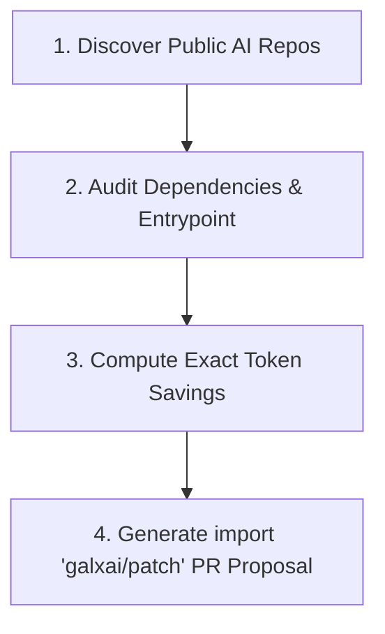

# 🔍 Playbook: GitHub Repository Audit & Non-Spam Migration Outreach

## 1. Ethical Principles & Anti-Spam Guardrails
- **Value First, Pitch Never**: Never send generic cold sales emails or open unsolicited marketing issues on GitHub.
- **Ready-to-Merge Value**: Only propose changes that include a working, verified git diff and a concrete mathematical ROI savings calculation.
- **Quarantine Outbox Requirement**: Every proposal generated by the GTM Board must be reviewed in `.data/gtm/outbox/` before external communication.

---

## 2. The 4-Step Technical Prospecting Protocol



### Step 1: Discover Repositories
Search GitHub for active public repositories containing:
- `"openai": "^4."` in `package.json`
- `from openai import OpenAI` in Python files
- `@ai-sdk/openai` in Next.js/React projects

### Step 2: Audit Entry Point
Locate the main entry file (`layout.tsx`, `index.ts`, `app.py`, `server.ts`).

### Step 3: Compute Exact Dollar Savings
Run the target repository's estimated token burn through the `gtm-roi-calculator`:
- Example: An active RAG documentation assistant running 20,000 queries/month.
- Retail OpenAI cost: **$180.00/mo**.
- GALXAI wholesale cost: **$98.00/mo** (**45.5% savings**).

### Step 4: Synthesize the Migration PR
Generate a clean PR description with code diff:
```markdown
### ⚡ Performance & Cost Optimization: Wholesale LLM Shimming

This PR reduces monthly OpenAI API expenses by **~45%** with **zero code modifications** to your prompt engineering or client calls:

\`\`\`diff
+ import 'galxai/patch';
  import OpenAI from 'openai';
\`\`\`

**Benefits**:
- 25%–40% wholesale discount on GPT-5.6 / GPT-4o models.
- 100% prompt cache pass-through (75% cache rebate).
- Sub-15ms Anycast edge failover across 300+ PoPs.
```
