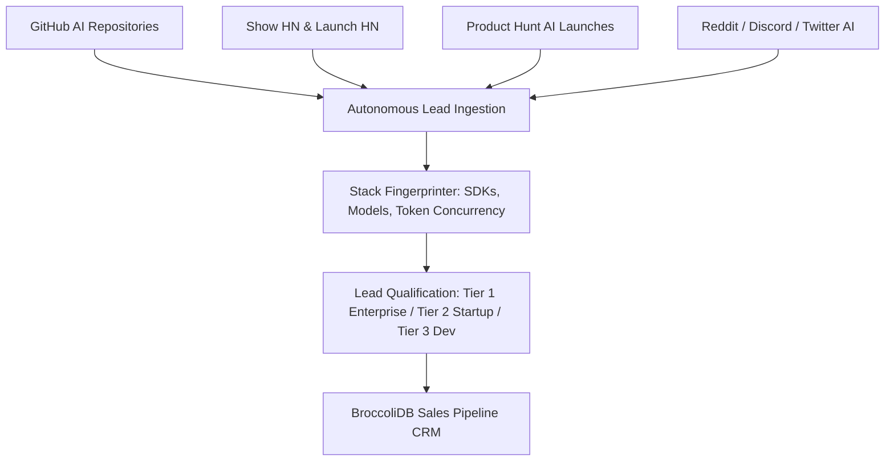

# 📡 High-Velocity Multi-Channel Lead Scraping Engine

## 1. Autonomous Prospecting Architecture
The GTM Board continuously monitors 4 high-yield channels to identify active engineering teams with high monthly LLM token burn:

---

## 2. Channel 1: GitHub High-Burn Repository Discovery
- **Search Queries**:
  - `path:package.json "openai"` AND `stars:>50`
  - `path:requirements.txt "openai"` AND `pushed:>2026-01-01`
  - `filename:layout.tsx "ai/react"` or `"@ai-sdk/openai"`
- **Extracted Metadata**: Maintainer GitHub login, repository star velocity, active contributors, dependency versions, API client entry points.

---

## 3. Channel 2: Hacker News (Show HN / Launch HN)
- **Scraping Filters**: Submissions containing keywords: `AI`, `LLM`, `Agent`, `RAG`, `GPT`, `Claude`, `Synthesizer`, `Copilot`.
- **Signal**: Startups launching new products have immediate token expenses and high urgency to protect margin.

---

## 4. Channel 3: Product Hunt Daily AI Radar
- **Monitoring Strategy**: Scrape daily Top 10 AI products, inspect live website network traffic for model API requests, extract maker Twitter/GitHub profiles.

---

## 5. Automated Stack Fingerprinting & Qualification Matrix
| Metric | Tier 1 (Enterprise) | Tier 2 (Growth Startup) | Tier 3 (Indie Builder) |
|---|:---:|:---:|:---:|
| **Estimated Monthly Spend** | **>$5,000 / mo** | **$500 – $5,000 / mo** | **<$500 / mo** |
| **Token Concurrency** | > 100 req/min | 10 – 100 req/min | < 10 req/min |
| **Outreach Protocol** | Custom Whitepaper + Shard Vault POC | 3-Touch Spend Teardown + $100 Grant | PR Diff + $5 Compute Trial |
