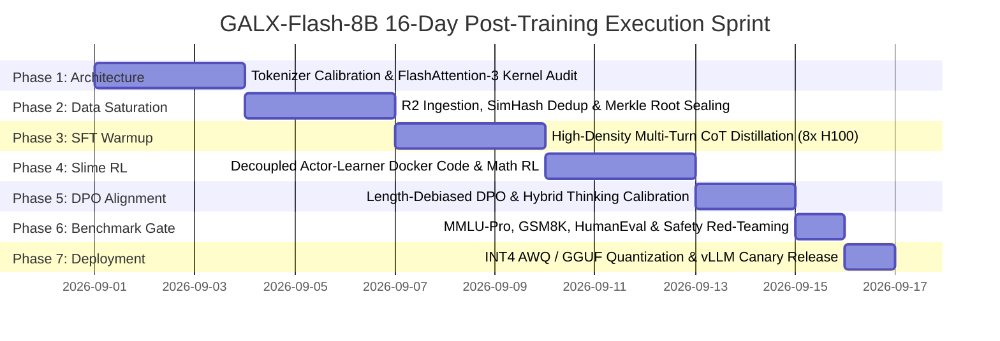
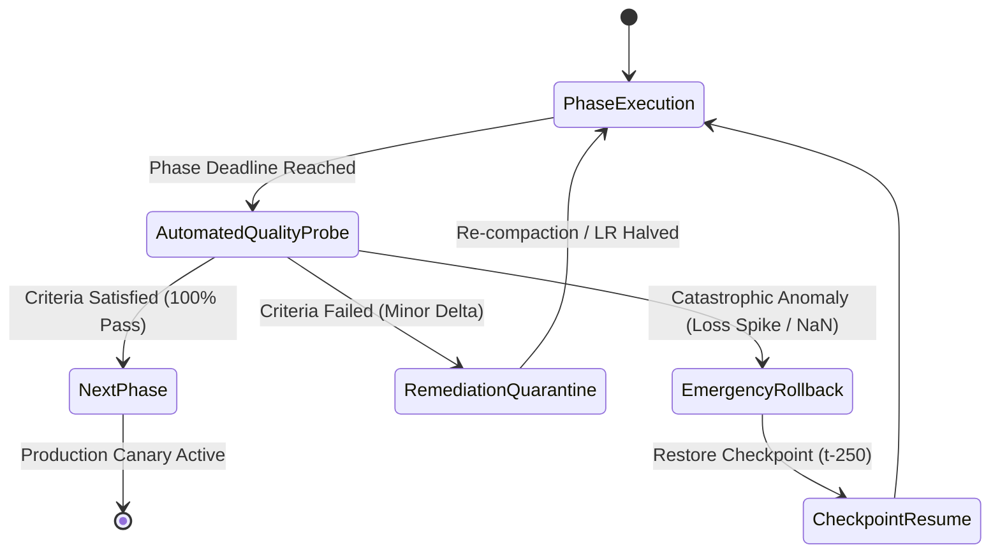

# 📅 Document 02: Timeframe & Sprint Milestones

<!-- docs-scope: research-reference -->
> **Reading scope:** Research, evaluation, or planning reference within its stated domain. Results and proposed mechanisms do not establish current federation behavior or production performance. See the [current contract](../FEDERATION_STRATEGY.md) and [complete catalog](../CATALOG.md).

## 16-Day 7-Phase Execution Timeline, Quantitative Quality Gates & Operational RACI

---

## 1. Master Sprint Timeline & Lifecycle FSM

The **GALX-Flash-8B** post-training run follows an adversarial, milestone-gated 16-calendar-day sprint designed to guarantee mathematical convergence, strict zero-PII retention, and production-grade inference velocity:

### Milestone State Machine Transition Protocol
Every phase transitions through an automated Go/No-Go Decision Gate:

---

## 2. Daily Operational Cadence (UTC)

To maintain absolute rigour during active cluster runs, engineering teams follow this synchronous daily rhythm:

| Time (UTC) | Cadence Event | Scope & Action Items | Primary Owner |
|---|---|---|---|
| **08:00** | **Morning Standup & Telemetry Audit** | Review WandB loss trajectories, validation perplexity, gradient norms, and GPU thermal/memory headroom over the preceding 24h. | Lead ML Engineer |
| **12:00** | **Midday Evaluation & Learning Rate Probe** | Execute 50-step synthetic validation probe; check for learning rate scheduler alignment and zero NaN gradients. | Systems SRE |
| **18:00** | **Automated Shard Compaction Trigger** | Issue `POST /api/internal/training` (`action: "compact"`) to consolidate new in-flight micro-shards into R2 cold storage. | Data Infrastructure Lead |
| **23:00** | **Daily Checkpoint Seal & Merkle Notarization** | Checkpoint snapshot upload to `datasets/checkpoints/`; generate SHA-256 Merkle proofs; backup adapter weights. | MLOps Operator |

---

## 3. Phase Deep Dives & Quantitative Go/No-Go Criteria

### Phase 1: Architecture & Tokenizer Calibration (Days 1–3)
- **Primary Mission**: Align ChatML tokenization format, integrate `<thought>...</thought>` dynamic budget delimiters, configure IndexShare 4-layer attention block reuse, and verify FlashAttention-3 GPU kernel compilation.
- **Quantitative Gate Criteria**:
  - $\text{Consistency}_{\text{Tokenization}} = 100.0\%$ (Zero special token ID collisions across 50,000 synthetic test strings).
  - IndexShare sparse attention kernel executes $\ge 2.85\times$ faster than dense attention at 128,000 sequence length.
  - FlashAttention-3 / SDPA kernel compilation completes with 0 warnings on NVIDIA H100 SXM5.
- **Deliverables**: Verified tokenizer config (`tokenizer.json`), chat template script (`chat_template.jinja`), and kernel benchmark telemetry logs.

---

### Phase 2: Data Engine Saturation & Merkle Sealing (Days 4–6)
- **Primary Mission**: Ingest $\ge 200,000$ high-quality interaction samples across 4 curriculum tiers, execute in-memory SimHash deduplication, perform Gzip shard compaction, and notarize the SHA-256 Merkle root manifest.
- **Quantitative Gate Criteria**:
  - Total Token Volume: $\ge 150,000,000$ high-quality tokens.
  - PII Scrubbing Leak Rate: Exactly $0.00\%$ across multi-pattern regex suites (AWS keys, Stripe keys, SSNs, IPs).
  - Intra-cluster Redundancy: SimHash 64-bit Hamming distance $<3$ collisions $\le 1.5\%$.
  - SHA-256 Merkle Tree Proof verification: $100\%$ valid via `npm run r2:verify`.
- **Deliverables**: Sealed `datasets/manifest.json.gz`, active presigned URL catalog (`?format=presigned_urls`).

---

### Phase 3: High-Density CoT Distillation SFT (Days 7–9)
- **Primary Mission**: Execute 3 epochs of Supervised Fine-Tuning on 8x NVIDIA H100 SXM5 GPUs using 4,096 sequence packing, cosine learning rate decay ($2\times 10^{-4}$), and DeepSpeed ZeRO-3 / FSDP.
- **Quantitative Gate Criteria**:
  - Final Training Loss: $\mathcal{L}_{\text{train}} \le 0.78$.
  - Final Validation Loss: $\mathcal{L}_{\text{val}} \le 0.85$.
  - Gradient Norm Stability: $0.4 \le \|\mathbf{g}\|_2 \le 1.2$ with exactly $0$ NaN / Inf occurrences.
  - Throughput SLA: $\ge 4,200\text{ tokens/second/GPU}$.
- **Deliverables**: Merged SFT checkpoint `checkpoints/sft_final_epoch_3.pt`.

---

### Phase 4: Slime Asynchronous Reinforcement Learning (Days 10–12)
- **Primary Mission**: Launch decoupled actor-learner RL using sandboxed Docker containers running Python REPL and Rust compilers to provide ground-truth programmatic reward signals.
- **Quantitative Gate Criteria**:
  - Python Code Compilation Pass Rate: $\ge 78.0\%$ on held-out validation tasks.
  - Math Solution Symbolic Verification: $\ge 84.0\%$ accuracy on symbolic algebra problems.
  - KL Divergence Penalty: $\mathbb{D}_{\text{KL}}(\pi_\theta \| \pi_{\text{ref}}) \le 0.15$.
- **Deliverables**: Policy weights after GRPO optimization (`checkpoints/rl_policy_final.pt`).

---

### Phase 5: Length-Debiased DPO & Hybrid Calibration (Days 13–14)
- **Primary Mission**: Execute DPO pass on 30,000 preference pairs ($\beta=0.1$) with length-debiasing to eliminate verbosity fluff and calibrate thinking token budgets.
- **Quantitative Gate Criteria**:
  - Fluff & Sycophancy Score: $\le 0.05$ (evaluating boilerplate apology and filler suppression).
  - Mode A (`non_thinking`) TTFT: $\le 45\text{ms}$.
  - Mode B (`thinking`) Token Budget: Calibrated to $1,500 \pm 300$ tokens on competition STEM problems.
- **Deliverables**: Aligned model weights (`checkpoints/galx_flash_8b_aligned.pt`).

---

### Phase 6: Benchmark & Red-Teaming Gate (Day 15)
- **Primary Mission**: Run automated benchmark harness across MMLU-Pro, GSM8K, MATH-500, HumanEval, and SWE-bench Lite, plus adversarial prompt injection testing.
- **Quantitative Gate Criteria**:
  - **HumanEval (Pass@1)**: $\ge 86.5\%$ (Exceeding GLM-5.3 Flash baseline of 85.2%).
  - **GSM8K**: $\ge 92.0\%$ (Exceeding GLM-5.3 Flash baseline of 91.0%).
  - **MATH-500**: $\ge 64.0\%$ (Exceeding GLM-5.3 Flash baseline of 62.8%).
  - **SWE-bench Lite**: $\ge 36.0\%$ (Exceeding GLM-5.3 Flash baseline of 34.5%).
  - **Adversarial Safety Refusal**: $\ge 99.5\%$ on harmful / malicious jailbreak prompts.
- **Deliverables**: Certified benchmark audit report & safety attestation signature.

---

### Phase 7: Quantization & Production Canary Deployment (Day 16)
- **Primary Mission**: Quantize model weights into INT4 AWQ and GGUF (Q4_K_M, Q8_0); deploy to vLLM edge worker pool with 5% canary traffic split.
- **Quantitative Gate Criteria**:
  - P99 Time to First Token (TTFT): $\le 45\text{ms}$.
  - Sustained Generation Throughput: $\ge 140\text{ tokens/sec}$ on single RTX 4090 / Mac M-Series.
  - Production 5xx Error Rate: $\le 0.01\%$ over 24 consecutive hours.
- **Deliverables**: Quantized model artifacts on Cloudflare R2 CDN, live canary routing on `api.galx.ai`.

---

## 4. Responsibility Assignment Matrix (RACI)

| Milestone Stage | ML Engineering Lead | Infrastructure SRE | Data Ops Lead | Evaluation Lead | Product Gateway Lead |
|---|---|---|---|---|---|
| **Phase 1: Architecture & Tokenizer** | **A / R** | C | C | C | I |
| **Phase 2: Data Saturation & R2 Sealing**| C | C | **A / R** | C | I |
| **Phase 3: CoT Distillation SFT** | **A / R** | R | C | C | I |
| **Phase 4: Slime Docker RL** | R | **A** | C | R | I |
| **Phase 5: DPO Alignment** | **A / R** | C | C | R | I |
| **Phase 6: Benchmark & Red-Teaming** | C | I | I | **A / R** | C |
| **Phase 7: Quantization & Canary** | C | **A / R** | I | C | **A / R** |

*Legend: **A** = Accountable (Final decision maker), **R** = Responsible (Executes work), **C** = Consulted (Provides input), **I** = Informed (Receives updates).*

---

## 5. Anomaly Escalation & Recovery Playbooks

| Anomaly Type | Detection Threshold | Automated Mitigation | Recovery Action |
|---|---|---|---|
| **Loss Spike / Explosion** | $\Delta \mathcal{L} > +0.4$ in 10 steps or NaN gradient | Process immediately killed by watchdog script. | Resume from last clean checkpoint ($t-250$) with $\text{LR} = \frac{1}{2}\text{LR}_{\text{prev}}$ and warmup $= 10\%$. |
| **InfiniBand Node Degrade**| Interconnect bandwidth $< 200\text{ Gbps}$ | Watchdog triggers NCCL ring fallback. | Migrate execution to standby 8x H100 node; stream checkpoint from R2 ($<90\text{s}$). |
| **Presigned URL Expiry** | HTTP 403 on R2 shard fetch | Engine triggers background renewal. | Auto-request fresh SigV4 signed URLs via `GET /api/internal/training?format=presigned_urls`. |
| **Docker Sandbox OOM** | Worker RAM usage $> 95\%$ | Docker daemon kills rogue container. | Worker re-spawns container with strict memory limit per execution ($2\text{GB}$). |
