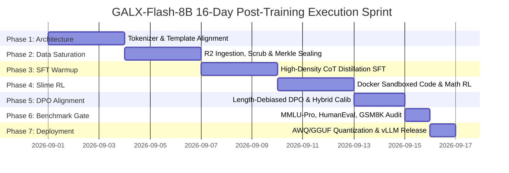

# 📅 Document 02: Timeframe & Sprint Milestones
## 16-Day 7-Phase Execution Timeline & Go/No-Go Quality Gates

---

## 1. Master Sprint Timeline Overview

The GALX-Flash-8B training sprint is structured into 7 contiguous, milestone-gated phases spanning 16 calendar days:

---

## 2. Phase-by-Phase Milestone Specification

### Phase 1: Architecture & Tokenizer Calibration (Days 1–3)
- **Objective**: Calibrate the base model tokenizer (ChatML format, `<thought>` system tags), configure IndexShare 4-layer attention blocks, and verify FlashAttention-3 GPU kernel compilation.
- **Key Deliverables**: Verified tokenizer JSON, dry-run tokenization script, and kernel benchmarks.
- **Go/No-Go Gate**: Round-trip tokenization consistency $\ge 99.99\%$ with zero special token ID collisions.

### Phase 2: Data Engine Saturation & Merkle Sealing (Days 4–6)
- **Objective**: Ingest $\ge 200,000$ high-quality interaction samples across 4 curriculum tiers, execute SimHash deduplication, perform Gzip shard compaction, and notarize the SHA-256 Merkle root.
- **Key Deliverables**: Sealed `manifest.json.gz`, active presigned URL catalog (`?format=presigned_urls`).
- **Go/No-Go Gate**: $\ge 150\text{M}$ high-quality tokens, 0% PII leak rate, Merkle proof integrity verification passing 100%.

### Phase 3: High-Density CoT Distillation SFT (Days 7–9)
- **Objective**: Execute 3 epochs of Supervised Fine-Tuning on 8x NVIDIA H100 SXM5 GPUs using 4,096 sequence packing, cosine learning rate decay ($2\times 10^{-4}$), and DeepSpeed ZeRO-3 / FSDP.
- **Key Deliverables**: SFT checkpoint `checkpoints/sft_final_epoch_3.pt`.
- **Go/No-Go Gate**: Training loss $\mathcal{L}_{\text{train}} \le 0.78$, Validation loss $\mathcal{L}_{\text{val}} \le 0.85$, 0 NaN gradients.

### Phase 4: Slime Asynchronous Reinforcement Learning (Days 10–12)
- **Objective**: Launch decoupled actor-learner RL using sandboxed Docker containers running Python REPL and Rust compilers to provide ground-truth programmatic reward signals.
- **Key Deliverables**: Policy weights after GRPO optimization (`checkpoints/rl_policy_final.pt`).
- **Go/No-Go Gate**: Code compilation pass rate $\ge 78\%$, Math solution accuracy $\ge 84\%$.

### Phase 5: Length-Debiased DPO & Hybrid Calibration (Days 13–14)
- **Objective**: Execute DPO pass on 30,000 preference pairs ($\beta=0.1$) with length-debiasing to eliminate verbosity fluff and calibrate thinking token budgets.
- **Key Deliverables**: Aligned model weights (`checkpoints/galx_flash_8b_aligned.pt`).
- **Go/No-Go Gate**: Fluff score $\le 0.05$, average reasoning token length within $1,500 \pm 300$ tokens on complex prompts.

### Phase 6: Benchmark & Red-Teaming Gate (Day 15)
- **Objective**: Run automated benchmark harness across MMLU-Pro, GSM8K, MATH-500, HumanEval, and SWE-bench Lite, plus adversarial prompt injection testing.
- **Key Deliverables**: Scored benchmark report and safety attestation.
- **Go/No-Go Gate**: HumanEval $\ge 86.5\%$, GSM8K $\ge 92.0\%$, MMLU-Pro $\ge 68.0\%$, Safety refusal accuracy $\ge 99.5\%$.

### Phase 7: Quantization & Production Canary Deployment (Day 16)
- **Objective**: Quantize model weights into INT4 AWQ and GGUF (Q4_K_M, Q8_0); deploy to vLLM edge worker pool with 5% canary traffic split.
- **Key Deliverables**: Production model weights on R2 CDN, active live canary routing on `api.galx.ai`.
- **Go/No-Go Gate**: P99 TTFT $<45\text{ms}$, throughput $>140\text{ tok/s}$, 5xx error rate $<0.01\%$.

---

## 3. Milestone Summary Table

| Milestone # | Phase Name | Target Deadline | Required Status | Critical Blocker / Owner |
|---|---|---|---|---|
| **M1** | Tokenizer & IndexShare Verification | Day 3 (23:59 UTC) | Complete | Kernel / Tokenizer Lead |
| **M2** | R2 Ingestion & Merkle Notarization | Day 6 (23:59 UTC) | Complete | Data Infrastructure Lead |
| **M3** | SFT Convergence & Checkpoint Seal | Day 9 (23:59 UTC) | Complete | Lead ML Engineer |
| **M4** | Slime Docker RL Verification Pass | Day 12 (23:59 UTC) | Complete | RL & Systems Lead |
| **M5** | DPO Alignment & Fluff Elimination | Day 14 (23:59 UTC) | Complete | Alignment Lead |
| **M6** | Benchmark Acceptance Audit | Day 15 (23:59 UTC) | Complete | Evaluation Lead |
| **M7** | vLLM INT4 Canary Production Release | Day 16 (23:59 UTC) | Complete | SRE & Edge Gateway Lead |
