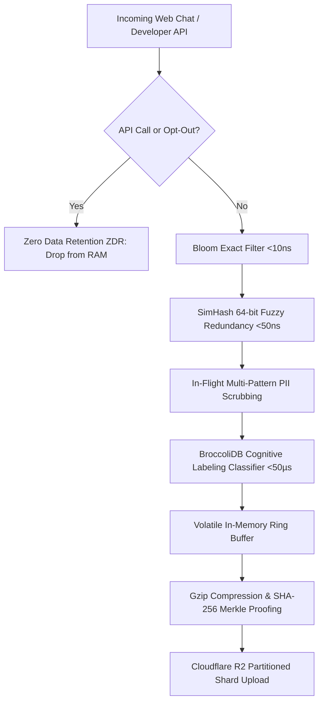

# 📊 Document 03: Dataset & Curriculum Specification
## 4-Tier Curriculum Mix, Ingestion Pipeline & Privacy Invariants

---

## 1. 4-Tier Curriculum Stratification

To endow **GALX-Flash-8B** with frontier reasoning and coding capabilities, training data is partitioned into four balanced curriculum tiers:

```
┌──────────────────────────────────────────────────────────────────────────────────┐
│                           4-Tier Curriculum Mix Overview                         │
├─────────────────┬──────────┬──────────────┬───────────────┬──────────────────────┤
│ Tier Name       │ Weight   │ Min Samples  │ Min Tokens    │ Target Domains       │
├─────────────────┼──────────┼──────────────┼───────────────┼──────────────────────┤
│ Tier 1: Fact CoT│ 20%      │ 40,000       │ 30,000,000    │ Factuality, System 1 │
│ Tier 2: Logic   │ 30%      │ 60,000       │ 45,000,000    │ Multi-step Logic, Math│
│ Tier 3: Code    │ 35%      │ 70,000       │ 55,000,000    │ Rust, Python, Tool Use│
│ Tier 4: STEM    │ 15%      │ 30,000       │ 25,000,000    │ Olympiad Math, Algorth│
├─────────────────┼──────────┼──────────────┼───────────────┼──────────────────────┤
│ **Total**       │ **100%** │ **200,000**  │ **155,000,000**│ Full Spectrum Engine │
└─────────────────┴──────────┴──────────────┴───────────────┴──────────────────────┘
```

---

## 2. Ingestion & In-Memory Data Pipeline



### 2.1 Invariant Guarantees
1. **Zero Data Retention (ZDR)**: Developer API traffic and opted-out consumer sessions strictly bypass training memory buffers.
2. **Volatile PII Redaction**: AWS access keys, Stripe keys, SSNs, credit cards, emails, and IPv4/IPv6 addresses are redacted in RAM prior to buffering.
3. **Sub-$50\mu\text{s}$ Cognitive Labeling**: The `BroccoliDataLabelingClassifier` extracts educational score, novelty ratio, and task categorization with zero filesystem overhead.
4. **Deterministic 90/10 Train/Validation Splitting**: MD5 hash modulo routing automatically segments shards into `split=train` and `split=validation`.

---

## 3. Storage Hierarchy on Cloudflare R2

Dataset shards are organized into partitioned, S3-compliant prefix hierarchies:

```
galxai-training-datasets/
├── datasets/
│   ├── sft/
│   │   └── v1/
│   │       ├── split=train/
│   │       │   └── curriculum=tier_2_intermediate/year=2026/month=08/day=30/sft_shard_001.jsonl.gz
│   │       └── split=validation/
│   │           └── curriculum=tier_2_intermediate/year=2026/month=08/day=30/sft_shard_002.jsonl.gz
│   ├── dpo/
│   │   └── v1/
│   │       ├── split=train/
│   │       └── split=validation/
│   ├── kto/
│   ├── microbatches/
│   ├── compacted/
│   ├── manifest.json.gz          # Master SHA-256 Merkle index
│   ├── README.md                 # Hugging Face Dataset Card
│   ├── index.json                # MosaicML StreamingDataset catalog
│   └── curriculum_state.json     # Curriculum tier progression
```

---

## 4. Verification & Audit Commands

```bash
# Execute local R2 dataset sync and probe
npm run r2:bootstrap

# Verify Merkle root derivation and Gzip decompression
npm run r2:verify

# Inspect active split distribution
curl "http://localhost:3000/api/internal/training?format=splits"
```
