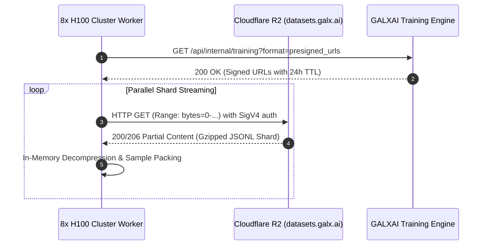

# 🖥️ Document 04: Hardware & Infrastructure Setup
## Multi-GPU Cluster Topology, Slime Docker Environment & Cloudflare R2 Streaming

---

## 1. Primary GPU Hardware Topology

To achieve rapid training turnaround and efficient distributed execution, we specify an **8x NVIDIA H100 (80GB SXM5)** cluster connected via 3.2 Tbps NVIDIA Quantum-2 InfiniBand:

```
┌─────────────────────────────────────────────────────────────────────────────┐
│                    8x NVIDIA H100 SXM5 Cluster Topology                     │
├───────────────────────┬─────────────────────────────────────────────────────┤
│ Hardware Attribute    │ Specification & Configuration                       │
├───────────────────────┼─────────────────────────────────────────────────────┤
│ GPU Accelerators      │ 8x NVIDIA H100 80GB SXM5 (640GB aggregate VRAM)     │
│ Interconnect          │ NVLink 4 (900 GB/s bidirectional per GPU)           │
│ Networking            │ 8x 400 Gbps InfiniBand (3.2 Tbps aggregate)         │
│ Host CPU & RAM        │ 2x Intel Xeon Platinum 8480+ (112 cores), 1.5TB RAM │
│ Storage Attached      │ 4x 3.84TB NVMe SSDs in RAID-0 (Local cache scratch) │
│ Cloud Provider        │ Lambda Labs, RunPod, or CoreWeave                   │
│ Target Compute Cost   │ ~$24.00 / hour (~$2,304 total for 96 compute-hours) │
└───────────────────────┴─────────────────────────────────────────────────────┘
```

---

## 2. Zero-Egress Cloudflare R2 Streaming Architecture

Unlike traditional training pipelines that require staging hundreds of gigabytes onto local cluster disks before execution, the GALXAI pipeline streams datasets directly into PyTorch data loaders using **SigV4 signed GET URLs**:



**Financial Impact**: $0.00 bandwidth egress fees regardless of epoch count or cluster re-runs.

---

## 3. Slime Docker Sandboxed Execution Environment

For **Phase 4: Slime Asynchronous Reinforcement Learning**, a dedicated worker node runs isolated container sandboxes to execute generated Python, Rust, and SQL code:

```bash
# Provision docker execution sandbox on CPU worker node
docker run -d \
  --name galx-eval-sandbox \
  --cpus="32" \
  --memory="64g" \
  --pids-limit=256 \
  --network none \
  --security-opt no-new-privileges \
  -v /tmp/galx_eval:/workspace:ro \
  galxai/sandbox-executor:latest
```

### Sandbox Security Constraints:
- `--network none`: Strictly air-gapped; no external socket connections.
- `--pids-limit=256`: Prevents fork-bomb denial-of-service.
- Read-only root filesystem with ephemeral memory-backed `/tmp` scratchpad.
