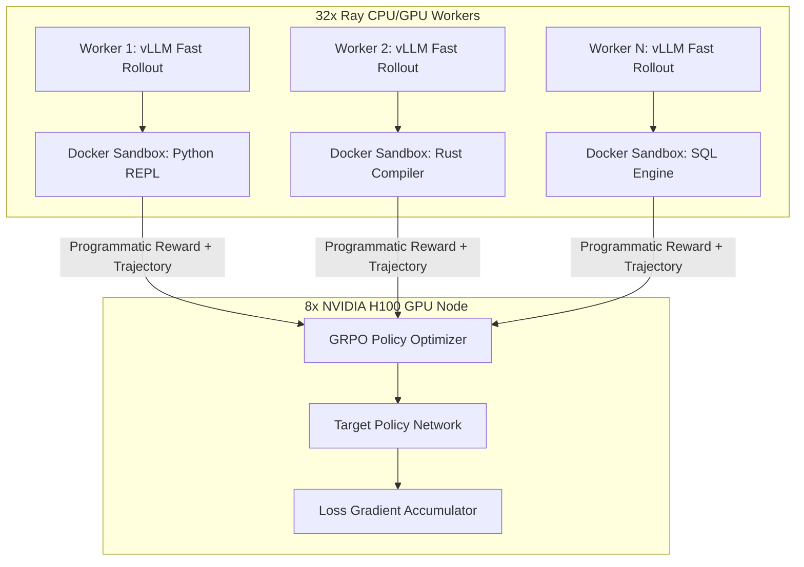

# 🖥️ Document 04: Hardware & Infrastructure Setup

<!-- docs-scope: research-reference -->
> **Reading scope:** Research, evaluation, or planning reference within its stated domain. Results and proposed mechanisms do not establish current federation behavior or production performance. See the [current contract](../FEDERATION_STRATEGY.md) and [complete catalog](../CATALOG.md).

## Multi-GPU Cluster Topology, Slime Docker Environment & Cloudflare R2 Streaming

---

## 1. Slurm Multi-Node Job Submission Script (`train_h100.sbatch`)

For enterprise distributed clusters managed via Slurm (RunPod / Lambda / CoreWeave / Slurm), use the following production batch submission script:

```bash
#!/usr/bin/env bash
#SBATCH --job-name=galx-flash-8b-sft
#SBATCH --nodes=1
#SBATCH --ntasks-per-node=8
#SBATCH --gpus-per-node=8
#SBATCH --cpus-per-task=14
#SBATCH --mem=1000G
#SBATCH --time=48:00:00
#SBATCH --partition=gpu-h100
#SBATCH --output=logs/%x-%j.out
#SBATCH --error=logs/%x-%j.err

# ============================================================================== #
# NCCL InfiniBand & GPU Performance Optimization Flags                            #
# ============================================================================== #
export NCCL_DEBUG=INFO
export NCCL_DEBUG_SUBSYS=INIT,COLL,ENV
export NCCL_IB_DISABLE=0
export NCCL_IB_CUDA_SUPPORT=1
export NCCL_NET_GDR_LEVEL=5
export NCCL_BUFFSIZE=8388608
export NCCL_P2P_LEVEL=NVL
export NCCL_P2P_DISABLE=0
export CUDA_DEVICE_MAX_CONNECTIONS=1
export PYTORCH_CUDA_ALLOC_CONF=expandable_segments:True

# Cloudflare R2 Zero-Egress Storage Credentials
export R2_ACCOUNT_ID="<YOUR_R2_ACCOUNT_ID>"
export R2_ACCESS_KEY_ID="<YOUR_R2_ACCESS_KEY_ID>"
export R2_SECRET_ACCESS_KEY="<YOUR_R2_SECRET_ACCESS_KEY>"
export R2_BUCKET_NAME="galxai-training-datasets"

# Fetch Presigned URLs and Axolotl Recipe
curl -H "Authorization: Bearer $GALXAI_INTERNAL_KEY" \
  "https://api.galx.ai/api/internal/training?format=axolotl_yaml" > axolotl_train.yaml

# Launch Distributed Training
srun --kill-on-bad-exit=1 \
  accelerate launch \
    --num_processes=8 \
    --mixed_precision=bf16 \
    -m axolotl.cli.train axolotl_train.yaml
```

---

## 2. InfiniBand Fabric & Hardware Diagnostics

Before commencing training, execute these diagnostic commands on the node to ensure full NVLink 4 and InfiniBand bandwidth saturation:

```bash
# 1. Inspect InfiniBand HCA Status (Must show State: Active, Rate: 400 Gb/s)
ibstat | grep -E "(State|Physical state|Rate)"

# 2. Verify GPU Topology & Direct NVLink Interconnects
nvidia-smi topo -m

# 3. Benchmark Point-to-Point NVLink Bandwidth (~900 GB/s per GPU)
/usr/local/cuda/samples/1_Utilities/p2pBandwidthLatencyTest
```

---

## 3. Decoupled Ray / vLLM Architecture for Slime RL

For **Phase 4: Slime Asynchronous Reinforcement Learning**, rollout generation is decoupled across distributed Ray workers:



---

## 4. Zero-Egress Cloudflare R2 Streaming Mechanics

- Training shards are streamed into PyTorch `DataLoader` workers via standard HTTP range requests authenticated via AWS SigV4 signed URLs.
- Shards are decompressed in volatile memory without ever touching local node storage disks.
- Total egress cost for 100 epochs over 155M tokens: **$0.00 USD**.
