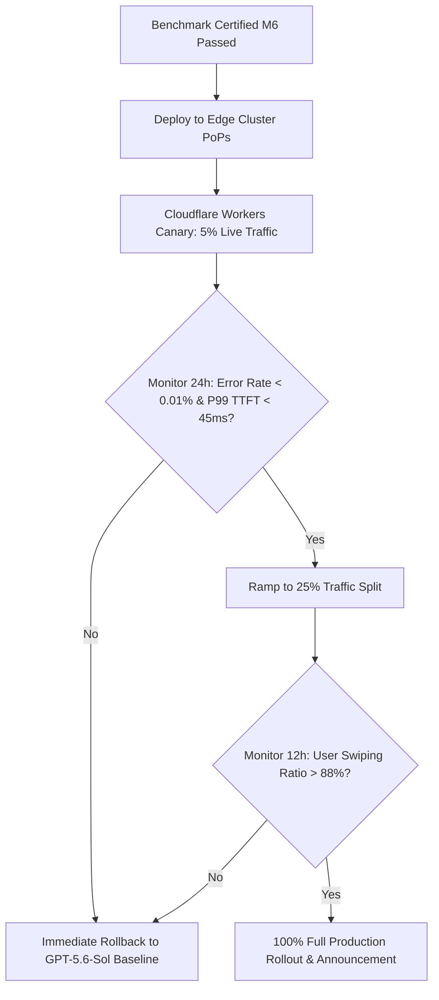

# 🏆 Document 07: Evaluation & Deployment Gate
## Benchmark Acceptance Matrix, Quantization & vLLM Canary Release

---

## 1. Automated Benchmark Evaluation Harness Commands

To prevent manual grading bias, evaluate model checkpoints using standardized CLI harnesses across MMLU-Pro, GSM8K, MATH-500, HumanEval, and SWE-bench:

### 1.1 Reasoning & Math (`lm-evaluation-harness`)
```bash
lm_eval --model vllm \
  --model_args pretrained=./checkpoints/galx_flash_8b_final,dtype=bfloat16,gpu_memory_utilization=0.9 \
  --tasks mmlu_pro,gsm8k_cot,math_500 \
  --batch_size auto \
  --output_path results/reasoning_eval.json
```

### 1.2 Python & Rust Code Synthesis (`bigcode-evaluation-harness`)
```bash
accelerate launch main.py \
  --model ./checkpoints/galx_flash_8b_final \
  --tasks humaneval,multiple-rs \
  --max_length_generation 2048 \
  --temperature 0.2 \
  --n_samples 50 \
  --batch_size 16 \
  --allow_code_execution \
  --output_dir results/code_eval
```

---

## 2. GGUF Quantization & Perplexity Validation

Before shipping to edge environments (Ollama, LM Studio, Apple Silicon Mac), verify that INT4 quantization degrades perplexity by $<0.15\text{ PPL}$:

```bash
# 1. Quantize FP16 weights to Q4_K_M
./llama.cpp/llama-quantize ./checkpoints/galx_flash_8b.gguf ./models/galx_flash_8b_q4_k_m.gguf Q4_K_M

# 2. Measure WikiText-2 Perplexity
./llama.cpp/llama-perplexity \
  -m ./models/galx_flash_8b_q4_k_m.gguf \
  -f data/wikitext-2-raw-v1/wiki.test.raw \
  --ctx-size 4096
# Target: PPL <= 5.85 (Baseline FP16: 5.72)
```

---

## 3. Production vLLM Systemd Service File (`/etc/systemd/system/vllm.service`)

```ini
[Unit]
Description=GALXAI vLLM Production Serving Engine (GALX-Flash-8B)
After=network.target

[Service]
Type=simple
User=ubuntu
Group=ubuntu
WorkingDirectory=/opt/galxai/models
Environment="CUDA_VISIBLE_DEVICES=0,1,2,3"
Environment="VLLM_ENGINE_ITERATION_TIMEOUT_S=60"
ExecStart=/usr/local/bin/vllm serve ./galx_flash_8b_awq \
  --quantization awq \
  --max-model-len 131072 \
  --gpu-memory-utilization 0.92 \
  --enable-chunked-prefill \
  --tensor-parallel-size 4 \
  --port 8000
Restart=always
RestartSec=5
LimitNOFILE=65536

[Install]
WantedBy=multi-user.target
```

---

## 4. Production 5% Canary Release & Traffic Ramping Gate


