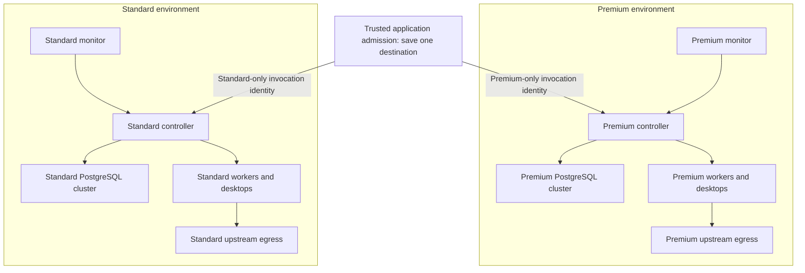

# Historical proposal: autonomous relay registries

<!-- docs-scope: research-reference -->

Historical September 15 proposal, superseded by the owner’s requirement to manage accounts only in GALXAI. The [central account contract](../central-account-control.md) is the current target. The former proposal and its evidence are preserved below; its account-registry and lease-placement instructions are not current.

Private proposed implementation contract, September 15, 2026 UTC. This replaces the [earlier shared-database proposal](../history/logical-pools-2026-09-15.md) in full following the requirement that the relays cannot intermingle or interact. It is not an accepted ADR or deployed configuration. [Current operating evidence](../../../post-mortem/CURRENT_STATE.md) remains authoritative.

## Decision: two independent deployment environments

Premium and Standard each own a complete relay environment: controller, workers, manually registered accounts, desktops, database cluster, credentials, network, monitor, queues, receipts and backups. Share reviewed source code and the intended model catalog. Do not share mutable runtime state or operational credentials.

Premium accepts paid upstream accounts and permits text, Sites and images. Standard accepts free upstream accounts and permits text only. This classification does not change GALX customer subscription entitlements. Capability evidence still determines whether a permitted workload is ready.

**No relay may call, query, discover, manage, decrypt for, or fail over to the other relay.** An outage stays within its destination: no text fallback, capacity borrowing, account transfer or peer status lookup. Two namespaces or two schemas inside the existing host/database do not meet this contract.

The closest documented model is AWS's [full-stack silo isolation](https://docs.aws.amazon.com/whitepapers/latest/saas-tenant-isolation-strategies/silo-isolation.html). We adopt its dedicated resource boundary while retaining one software implementation. The [multiple-account model](https://docs.aws.amazon.com/whitepapers/latest/organizing-your-aws-environment/benefits-of-using-multiple-aws-accounts.html) separates permission and operational boundaries. These are architecture references, not a decision to purchase AWS infrastructure.

## Boundary and trusted exceptions

The boundary must survive a compromised relay runtime or its pool-scoped operator credential. That identity must not gain access to the peer environment, even with a known peer address or account ID. A scoped administrator may manage its own environment but cannot assume the peer's roles.

Use separately administered VMs/hosts, Docker daemons and infrastructure accounts/projects with disjoint grants. Two users controlling one unrestricted Docker daemon are not isolated administrators: [Docker documents](https://docs.docker.com/engine/security/) that daemon control can grant host filesystem access. Two PostgreSQL database names in one cluster also share cluster-wide roles and administration; [PostgreSQL's database overview](https://www.postgresql.org/docs/current/manage-ag-overview.html) makes that distinction explicit. Use separate clusters and independent access credentials.

A trusted GALX admission service can send a new operation to one fixed destination. A trusted administrator provisioning process can allocate account ownership before registration. Neither relay receives authority to call these services as a customer, select a different destination, or read the other's inventory. These are explicit trust boundaries outside both relay environments, not relay-to-relay channels.

This does not claim isolation from the human/organization administrator authorized over both environments, a compromised common software supply chain, the shared upstream provider, or a common hypervisor/infrastructure outage. Independent availability requires separately verified placement and failure domains. Hardware separation cannot be inferred from two project names.

## Resource ownership

| Resource | Required separation | Reject at deployment review |
| --- | --- | --- |
| Compute and supervisor | Separate VM/host identities, local controller service, local Docker daemon and deploy role | Shared daemon/socket, host PID/network namespace, privileged peer access or one deploy credential managing both |
| Configuration | One immutable local pool/instance identity; explicit environment and secret references | Shared `.env.local`, missing pool defaulting to Premium, ambient fleet secrets or alternate relay URL |
| PostgreSQL | One independent cluster per pool; local singleton identity; local runtime/operator/monitor principals | Same cluster under two database names, foreign servers/dblink, cross-cluster subscriptions, broad service-key fallback |
| Account material | Destination-approved identities; own encryption key, browser home, credential revisions and refresh state | Copied tokens, shared home volumes, common decryption key or global credential polling |
| Network | Separate private networks; deny both directions; destination-specific ingress authentication | Peering, shared internal bridge, dual-homed runtime, host gateway escape or access to the other public relay endpoint |
| Ingress and egress | One ingress identity for each destination; explicit upstream egress allowlist | Wildcard egress, access to GALX admission/admin endpoints from workers, arbitrary redirects or client-supplied fetch destinations |
| State and recovery | Own cache, queue, lease authority, receipts, dedupe records, artifact storage, signing keys and retry budget | Shared Redis/key prefix only, common queue, peer recovery URL or recomputing destination after a timeout |
| Monitoring | Own collector, origin, operator policy, session signer, logs, alerts and status cache | Shared bearer cookie, cross-pool queries, common writable operational index or embedded peer console |
| Backups and restore | Own encrypted backup destination, restore identity and original pool binding | Peer bucket access, restoring one pool's backup as the other, copying retained signing state into a new identity |

A different key name, URL, bucket prefix, username or schema name is not proof of a different authority. Verify actual project/cluster IDs, grants, key provenance and network routes. Keep this inventory in private administrative evidence, never the browser bundle.

## Network rules

There is no edge between the relay environments. Each controller has only its own credentials and local resource inventory. The app's invocation identities cannot enroll accounts, read credentials or operate monitors. Prefer separate per-destination dispatch processes so neither dispatcher holds the peer's credential; the admission record binds the job before sending.

Within an environment, permit only necessary component connections. Workers and sign-in desktops cannot reach the database, Docker API, monitor/admin ingress, metadata services or peer workloads. A controller may orchestrate only its own daemon. Independently scoped egress permits required provider destinations; it must not expose a general CONNECT proxy that can reach the peer or GALX application ingress. Validate redirects and DNS resolution at the network enforcement layer, including IPv4 and IPv6. A public address does not grant permission to connect.

[Docker's bridge documentation](https://docs.docker.com/engine/network/drivers/bridge/) explains why the current default bridge is insufficient and why publishing a port can create a path between otherwise separated bridges. The local proof uses internal networks and publishes no ports. Production still needs ingress, controlled provider egress and separate host authority; the laboratory network is not a ready-to-deploy topology.

## Database schema: one pool installed per cluster

Retain one maintained migration implementation, applied separately with a protected installation identity. Each cluster contains its own `private.relay_identity` singleton: immutable pool ID, instance ID, upstream account class and policy revision. Premium's cluster contains no Standard catalog, account, key or operation rows, and vice versa. Display labels are editable metadata; ownership is not.

| Local record | Invariant |
| --- | --- |
| Installation identity | Exactly one destination, fixed by provisioning; runtime cannot insert, update or delete it |
| Account | Stable provider identity, local desktop binding, approved allocation, assignment revision; local account/desktop uniqueness |
| Credential | Same local account/assignment, independently encrypted envelope and key version; absent from monitor projections |
| Workload policy | Premium: text/Sites/images; Standard: text. Check constraints prevent Standard policy expansion |
| Capability evidence | Own account, credential revision, workload and bounded freshness; policy permission does not imply readiness |
| Registration | Original operation ID, intent digest, consumed admission approval, revision and durable outcome |
| Authoritative leases/receipts | Original installation/account/generation/workload, request digest and settlement state; preserve the existing sole lease protocol |
| Registry events and artifacts | Local authority and retention; allowlisted projections and destination-bound retrieval; no peer subscriptions |

Use composite ownership references even within one cluster to detect wrong-destination imports and corrupt joins. Local RLS, column privileges, invoker views and non-bypass definer ownership still separate controller/operator/monitor authority. The [69-check SQL experiment](../schema-proof/README.md) remains evidence for these mechanisms, not justification for sharing a production database.

No pool controller receives `postgres`, `BYPASSRLS`, table ownership, credential-writer membership or a broad Supabase service key. No connection failure widens authority. Verify the actual direct/pooler connection identity before using a `session_user` binding. Function execution is explicitly granted: the earlier proof caught inherited `PUBLIC EXECUTE` and corrected [owner-level default privileges](https://www.postgresql.org/docs/current/sql-alterdefaultprivileges.html).

## Exclusive accounts without an online shared registry

Two disconnected databases cannot independently enforce one global unique account constraint. Checking both from a relay would reintroduce the interaction being removed. Resolve ownership during **administrator provisioning**, outside either runtime:

1. A single-writer, durable administrative allocation ledger records stable upstream account identity, exactly one destination, allocation revision and status. It contains no account token, browser home or provider output. Only the trusted provisioning identity accesses the full ledger.
2. After explicit operator account review, provisioning issues a signed admission approval for that account, fixed pool/instance, desktop binding, registration operation and allocation revision. Use separate issuance keys per destination. The relay holds only its own verification key. Approvals are narrowly scoped, expire, and never appear in URLs or browser storage.
3. A privileged server-side import delivers the approval only to its destination. The local registrar verifies signature, audience, authenticated sign-in identity, operation, desktop, time window and allocation revision before atomically consuming the approval with the account registration. Replaying that exact operation recovers its original result; changing intent is rejected.
4. Reserve ownership before issuing an approval. Issuance interruption, import timeout or missing acknowledgement retains the reservation. Recover the original allocation and operation. Do not release the account because a response was lost.
5. The ledger may be offline between registration changes. Existing local work remains independent. Unavailable provisioning blocks **new approvals**, not status reads or already approved operations. Expose “Awaiting registration approval” with resumable progress in the private console.

The privileged provisioning process can collect explicitly operator-confirmed pending registration records through a narrow administrative read and deliver the resulting approval through a separate import. These connections originate outside the relay environments. Each destination exposes only its own allowlisted draft metadata, never tokens or another pool's records. The operator's Register action saves that local task; it does not give the relay a credential for the allocation ledger. Provisioning failures leave the task pending with its original identity.

This approval protocol is proposed, not implemented by either proof. Its production acceptance must test concurrent allocation, sign-in identity substitution, wrong signer/audience/desktop/operation, expiry, duplicate consumption, lost acknowledgements and administrative backup recovery. Expiry prevents late enrollment; it does not itself revoke a previously registered account.

**No account moves between pools in v1.** Keep retired identities reserved permanently rather than freeing them when a registration fails or credentials expire. Immediate runtime revocation remains local to the owning environment; restoring old keys or backups must not undo it. A later transfer would require authoritative fencing of old credentials, desktops, receipts and stale installations before issuing a new approval. Until that exists, do not offer a transfer command.

If no external allocation authority is allowed at all, cross-pool uniqueness becomes a manual operational promise. Do not claim both autonomous disconnected registration and a globally atomic uniqueness guarantee. This design chooses trusted provisioning while keeping the relays independent.

## Request ownership and workload denial

The private GALX invocation record stores one destination before the first dispatch. Policy can assign a **new** text request to either eligible pool; it cannot change that request's destination afterward, even following a definite rejection. A deliberate new user operation gets a new request identity. Retrying, polling, cancellation and artifact retrieval always use the original destination.

Every hop checks the fixed destination and workload: application admission, destination ingress, lease acquisition, controller and worker. Request IDs alone are insufficient; bind the request digest, account assignment and execution generation. Each destination uses its own signing key and audience. A relay cannot return a URL or instruction that causes the app to forward credentials or work to the peer.

Standard rejects Sites/images before capacity selection or any provider call. Cover aliases, generic tool requests, startup qualification, credential renewal, background probes, preflight and synchronous/asynchronous endpoints. Premium unavailability never creates Standard work. There is no public route override or pool selector. Public errors describe unavailable capability without topology or upstream authentication detail.

Move the application's relevant lease operation to its chosen authority too. Reserving an account in the former shared registry while executing in a separate relay database would create conflicting ownership and budget evidence. Do not revive retired tier RPCs or add a competing lease ledger.

## Two monitors with familiar, fixed context

Use the same **Overview · Accounts · Activity · Settings** interface in two separately addressed, administrator-authorized consoles. Adopt [AWS's separate console-session pattern](https://docs.aws.amazon.com/awsconsolehelpdocs/latest/gsg/multisession.html): clear destination names that remain visible in parallel tabs. Color supplements text; it does not establish authorization.

- Persistent title and header: **Premium relay · Paid accounts** or **Standard relay · Free accounts**. Every registration confirmation repeats its fixed destination. No pool dropdown, global account search, cross-pool row, aggregate operational dashboard or move action.
- The external launcher contains two ordinary named destinations. Each destination establishes its own session. Do not carry tokens, cookies, registration IDs or message-channel state between consoles; use no opener relationship. Neither monitor fetches the other's health.
- Use separate hostnames, independent signing keys and exact audience/origin validation. Set administrator sessions with `Secure`, `HttpOnly`, host-only `__Host-` cookies and `Path=/`, without `Domain`; validate the supported-browser behavior described by [MDN](https://developer.mozilla.org/en-US/docs/Web/HTTP/Reference/Headers/Set-Cookie#cookie_prefixes). Reject ambiguous duplicate session cookies. [Cookies are not isolated by port](https://www.rfc-editor.org/rfc/rfc6265.html#section-8.5), so the prototype's two loopback ports demonstrate interaction only. SameSite alone does not replace origin/CSRF validation. Monitor permission remains read-only; a separately authorized operator grant enables registration.
- Keep sign-in desktops, browser profiles and downloads separate. Sign-in opens the selected account's local desktop; it must not reuse the other pool's signed-in browser home.
- Registration remains resumable: **Prepare workspace → Sign in → Review account → Verify and enable**. Administrative approval is a durable state within the review/save step, not a token-paste chore. Technical signing/ledger details stay server-side.
- “Registration outcome unconfirmed” offers **Check saved result** in the same console. “This account cannot be registered here” retains the draft without exposing another pool's identity or offering an automatic move.
- Standard shows Sites/images as **Not enabled on Standard**, without red health alarms or probe buttons. Premium exposes separate workload readiness and targeted failed-check recovery.
- A disconnected monitor labels its own last snapshot and disables unsafe mutations. It does not infer anything about the peer. Pool pause, account pause, monitor refresh and desktop stop remain distinct actions.

The [interaction prototype](../prototype/README.md) already exercises fixed destinations and resumable registration. It does not implement real administrator sessions, administrative approvals, separate-host deployment or this complete boundary. No new formal UX score or independent critique is claimed.

## Current-code findings and cutover

| Gap found in source inspection | Consequence under this contract |
| --- | --- |
| [Installer](../../../scripts/install-federation-service.ts) always passes the root `.env.local` | A second namespace would inherit existing authority. Replace it with explicit destination configuration and disjoint deployment identities. |
| [Worker driver](../../../src/relay/docker-shard-driver.ts) omits `--network`; controllers call the host Docker daemon | Namespace labels prevent cooperative ownership mistakes, not lateral access or daemon-level administration. Separate hosts/daemons and install explicit networks. |
| [Desktop driver](../../../src/relay/desktop-manager.ts) creates separate desktop networks/homes but uses the same daemon | Preserve per-desktop restrictions inside each environment; they do not establish a cross-environment boundary alone. |
| [Registry sync](../../../src/relay/shard-registry-sync.ts), [projection reader](../../../src/lib/supabase/repositories/ShardProjectionReader.ts) and [repository](../../../src/lib/supabase/repositories/ShardRepository.ts) use the current global authority | Replace all transports, decryption, writes, projections and lease paths together; never download both pools and filter afterward. |
| Application Sites/image paths share relay URL configuration; generic dispatch/probes lack the new destination/workload contract | Add immutable request ownership and gates before provider calls. Endpoint renaming alone is insufficient. |

The post-upgrade read-only version inventory reported 108 applied application migrations and none pending. [Two new Supabase projects](../provisioning-status.md) were created and verified healthy with zero GALX application tables. This is database provisioning evidence, not an ACL, runtime or cross-project isolation audit. The [delivery plan](../delivery-plan.md) describes the remaining implementation sequence.

Delivery order:

1. Record this target in a proposed ADR and inventory actual authority, unresolved operations and retained state. Preserve the current production namespace, receipts and signing state in their original environment until recovery is settled. Do not clone them into two destinations.
2. Prepare reviewed per-destination infrastructure/configuration and independent database provisioning. Preflight real resource IDs, grants, network routes, egress, backups and secret provenance. Premium is a display label, not permission to auto-classify existing accounts.
3. Implement administrative allocation and compatible local registry/lease/session adapters. Write paired migrations and rollback procedures for the affected databases. Retain unassigned historical records outside active capacity.
4. Bring up both environments empty, with separate monitors and prohibited routes denied. Run network, authority, stale-identity, recovery and zero-provider-call tests. Existing manually enrolled data must follow a reviewed exclusive transition; no dual writing or simultaneous old/new admission.
5. Manually register a free account and a paid account through their appropriate consoles after that transition is safe. Verify only intended workloads and retain consuming-probe approval. A plan declaration is not provider readiness evidence.
6. Activate destination-bound application dispatch in stages. Audit raw public responses, headers, errors, async retrieval and image artifacts, and scan rendered pages/browser assets. Public content must contain no operational topology.

Rollback stops new admission at the affected destination and preserves local ownership, original receipts and uncertainty. It does not restore a shared database credential, merge pools or replay work through the peer. A destination's restore must verify its original identity before admitting work. Avoid releasing account reservations during rollback.

## Verification and remaining scope

The [new network/database proof](../isolation-proof/README.md) passed **43 checks** against two real clusters: distinct credentials, no published ports, both-direction network denial and independent database outages. The earlier [SQL proof](../schema-proof/README.md) covers scoped grants, row policies, ownership references and operation recovery. Neither runs production adapters or establishes the final deployment.

Outstanding acceptance includes separate-host/administrator enforcement, IPv6 and controlled egress, TLS identities, real cross-console session rejection, approval issuance/consumption, cache/queue/backup authority, pinned request recovery and Standard zero-upstream Sites/image behavior across every route. A passing laboratory test cannot substitute for those checks.
