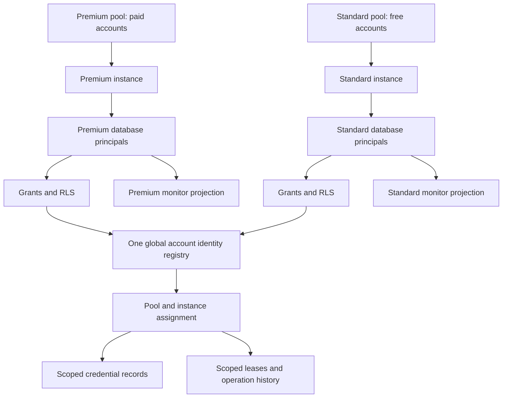

# Historical proposal: logical database pool isolation

<!-- docs-scope: research-reference -->

Archived September 15, 2026 after the user required no relay-to-relay interaction. This preserves the earlier shared-database experiment and rationale; it is not the current target or a rollout procedure. The [strict separation contract](../strict-isolation.md) replaces this proposal in full.

September 15, 2026 UTC. Proposed production schema and tested isolation pattern. The [executable proof](../schema-proof/README.md) runs in its own empty PostgreSQL database; it is not a deployed migration or a replacement for the existing registry. [Current operating evidence](../../../post-mortem/CURRENT_STATE.md) remains authoritative. This document extends the [two-relay specification](../README.md).

## Decision

Create two first-class relay pools: **Premium** for paid upstream accounts and **Standard** for free upstream accounts. Both use the same intended model catalog. Only Premium permits Sites and images. Pool membership represents upstream capacity, independently of GALX customer billing and the older `tier_pool` field.

Keep one global identity for each upstream account and one maintained schema implementation. Add immutable pool/instance ownership to operational records, give every relay its own database login, and enforce that ownership with grants, row-level security (RLS), and composite foreign keys. RLS makes an unfiltered query see only the caller's authorized rows. A composite foreign key requires related records to agree on pool, instance and account assignment.

Use two private namespaces, `relay_premium` and `relay_standard`, for pool-specific operator projections. Their names make the boundary recognizable. The grants and RLS enforce it. Credentials belong outside monitor projections; each controller may read only its own pool's encrypted envelopes. Do not create independently managed copies of the upstream identity registry.

This is logical database isolation within the existing PostgreSQL deployment. Database owners, infrastructure administrators and shared host failures remain outside that boundary. Separate databases or projects are the next boundary if those threats must also be isolated; that requires an explicit design for global identity arbitration, backup, routing and recovery.

## Familiar patterns and their limits

| Established pattern | Adaptation here |
| --- | --- |
| [GitHub runner groups](https://docs.github.com/en/actions/concepts/runners/runner-groups) collect runners under access policies; a runner belongs to one group | One account belongs to one pool. Capability matching occurs within that pool. Do not copy GitHub's automatic default-group assignment: existing GALX records need explicit classification. |
| [Kubernetes namespaces and RBAC](https://kubernetes.io/docs/concepts/security/multi-tenancy/) combine named resource groups, service identities, permissions and quotas | Separate pool namespaces and machine identities, with per-pool limits. Names alone do not isolate workloads or shared infrastructure. This proposal does not introduce Kubernetes. |
| [PostgreSQL schema privileges](https://www.postgresql.org/docs/current/ddl-schemas.html) govern cross-schema access | Separate private namespaces, revoke unnecessary access, and use fully qualified references in privileged functions. A schema is not an independent database. |
| [Supabase RLS and grants](https://supabase.com/docs/guides/database/postgres/row-level-security) separate permission to use a table from permission to see rows | Define both. Keep Data API exposure closed and reject ordinary authenticated users; never hand a pool controller the fleet-wide service key. |

These are adaptations of documented patterns, not claims that the referenced products use GALX's proposed tables.

## What the existing schema does

- [The account type](../../../src/lib/supabase/types.ts) includes `tier_pool`, encrypted credentials and the manual desktop binding. It has no relay-pool/instance assignment.
- [The old tier migration](../../../supabase/migrations/20260901000055_galxai_tier_shards_and_predictive_routing_mesh.sql) defaulted to `universal_global` and included fallback to that pool. Its competing lease paths were [retired](../../../supabase/migrations/20260904200000_galxai_retire_competing_shard_authorities.sql). Do not revive them to implement this split.
- [Manual enrollment](../../../supabase/migrations/20260914231914_manual_desktop_shard_enrollment.sql) already preserves global account identity, unique desktop ownership and explicit credential authority. It deliberately limits enrollment/refresh to private functions reached by the administrator connection. Preserve those invariants while replacing fleet-wide runtime authority with scoped principals.
- [Controller registry reads](../../../src/relay/shard-registry-sync.ts), [application projections](../../../src/lib/supabase/repositories/ShardProjectionReader.ts), and [repository lease methods](../../../src/lib/supabase/repositories/ShardRepository.ts) are not pool-scoped. The projection's fallback can use the broad Data API administrator credential. A failed scoped connection must never fall back to this broader identity.
- Existing leases and append-only registry events remain authoritative records. Pool separation must extend their ownership contracts and retention, not start a second competing lease ledger.

The read-only `npm run db:status` check on September 15 reported **108 applied, zero pending, zero remote-only migrations**. That verifies version inventory, not live role ACLs, table contents or deployed pool isolation.

## Proposed production data contract

Names below specify the target relationships; final migration names and placement require compatible adapter work.

| Record | Essential fields and constraints |
| --- | --- |
| `private.relay_pools` | Stable ID/code, display name, upstream account class, admission state, policy revision. Seed exactly Premium/paid and Standard/free. No automatic universal/default pool. |
| `private.relay_instances` | Immutable instance ID, `pool_id`, retained controller namespace, lifecycle. Unique `(pool_id, instance_id)` supports ownership references. Display renames do not change identity. |
| Private machine-principal bindings | Authenticated database principal → one pool, instance, role and enabled state. Runtime cannot edit these bindings or grant itself another role. |
| `galx_shard_accounts` | Preserve global `id` and unique desktop binding. Add `relay_pool_id`, `relay_instance_id`, `assignment_revision`; require a valid paired assignment before new admission. Existing records initially remain unassigned. |
| Private credential records or tightly restricted columns | Own pool/instance/account assignment, encrypted envelope and key version. Separate credentials from monitor metadata; never grant monitor roles access to envelope columns. |
| Pool workload policy | Primary key `(pool_id, workload)`. Premium permits text/Sites/images; Standard permits text. A database check prevents Standard gaining a Sites/image policy row accidentally. |
| Capability evidence | Own pool/instance/account assignment, workload, credential revision, observation/freshness data. Policy permission and verified readiness remain different facts. |
| Registration operations | Original operation ID, owning pool/instance, intent fingerprint, durable outcome and assignment revision. Retain enough state to distinguish rejected, committed, pending and unknown saves. |
| Existing leases/receipts | Original pool, instance, account assignment, workload and request identity. Related account/workload keys must agree. Original execution generation, token accounting and uncertain-outcome rules remain intact. |
| Registry events/projections | Preserve append-only history and explicitly scoped event envelopes/cursors. Account removal cannot cause another pool's cache to purge or import rows. |

The shared box coordinates uniqueness. Neither pool's ordinary credentials gain fleet-wide access to it. Do not partition account identity into separate tables with only `(pool_id, account_id)` uniqueness: that would allow the same upstream account in both pools. Display names may repeat across pools; account identity may not.

For the additive production migration, make unassigned state explicit: both ownership IDs are null and `assignment_revision=0`; assigned state requires both IDs and a positive revision. Enforce the pair with a check constraint. A half-assigned row is invalid, and an unassigned row is ineligible at the authoritative lease check. The proof contains only newly assigned synthetic accounts, so its columns are non-null and start at revision 1.

Pool-local idempotency does not deduplicate a request sent to both relays. The application must persist a single request home—original pool and instance—in its existing authoritative invocation/receipt record before dispatch. Retries use that home. Text may choose either eligible pool initially; moving a request after dispatch requires positive evidence that the original instance did not accept it. A timeout, missing local cache entry or unavailable status endpoint is insufficient. Sites/images always choose Premium. Keep this routing record private and exclude its pool fields from public DTOs.

### Authority matrix

| Principal | Permitted access | Denied access |
| --- | --- | --- |
| Premium controller | Own assigned credentials, evidence and lease operations; allowed Premium workloads | Standard rows, registration, principal administration and schema changes |
| Standard controller | Own assigned credentials, text evidence and lease operations | Premium rows, Sites/images, registration and schema changes |
| Pool operator/registrar | Own metadata and narrowly defined manual enrollment, credential handoff and pause operations | Direct credential-table reads, generic row writes, other pool assignments |
| Pool monitor | Own allowlisted metadata and operational status | Envelopes, enrollment, traffic changes and role changes |
| Fleet/database administrator | Explicit audited setup, grants, classification and recovery | No claim of technical isolation from this trusted administrator |
| Ordinary GALX user / generic Data API client | No operational schema access | Pool catalog, topology, credentials, leases and diagnostics |

These are server-side machine grants. Each monitor HTTP request still requires administrator authorization; a signed-in customer is not an operator. A browser never receives a database password. A central application router should hold only the required relay invocation capability, not registry enrollment or decryption authority.

## Enforcement details that matter

1. **Bind to authenticated identity.** The proof uses separate PostgreSQL logins and a protected mapping keyed by `session_user`. A request body, query parameter, editable JWT field or `SET app.pool_id` cannot choose a pool. Verify the actual Supavisor/direct connection behavior before adopting this exact mechanism. PostgREST commonly uses a shared authenticator, so it cannot simply reuse this assumption.
2. **Remove broader fallback authority.** Pool processes must not retain `postgres`, `BYPASSRLS`, table-owner membership, the no-login credential writer or a broad service key. [PostgreSQL documents](https://www.postgresql.org/docs/current/ddl-rowsecurity.html) that superusers and `BYPASSRLS` roles bypass RLS even with forced policies. Set both `USING` and `WITH CHECK`, and grant only needed operations.
3. **Restrict privileged functions.** Use a dedicated `NOLOGIN NOBYPASSRLS` owner, a trusted search path and explicit object names. Revoke `PUBLIC EXECUTE` before selective grants. The proof caught that a per-schema default revoke cannot remove PostgreSQL's global function default; [the documented fix](https://www.postgresql.org/docs/current/sql-alterdefaultprivileges.html) is an owner-level default change plus explicit grants/revokes for existing routines.
4. **Preserve global uniqueness under contention.** A global unique account key and desktop key remain necessary even when RLS hides foreign rows. Serialize conflicting registration operations, then translate uniqueness failures into a bounded operator conflict without foreign labels, credentials or database detail. Only a separately authorized fleet operator may inspect the conflict's owner.
5. **Constrain every relationship.** Pool-only filtering on accounts does not protect leases, credentials or evidence. Composite ownership references prevent a Standard lease or credential row from referencing a Premium account. Pool/workload references prevent forbidden capability records too.
6. **Preserve original outcomes.** A pause stops new admission; it does not erase existing operation identity. An unknown lease remains on its original instance. Never relabel or replay it into the other pool. Use explicit `paused=true/false` with a revision, rather than a replayable toggle.
7. **Scope caches and budgets.** Cache keys include immutable database authority, pool, instance and assignment generation. The two processes need distinct cursors and bounded shared-host/registry budgets. A global cache, broad fallback or reused signer can undo an otherwise correct database split.
8. **Keep workload denial in both layers.** Database constraints defend policy and lease records. Controller and worker gates must also reject Standard Sites/images before a provider call, including startup probes and alias qualification. The SQL proof cannot certify zero provider traffic in those still-unmodified runtime paths.
9. **Separate envelope authority.** Use pool-specific decryption authority or keys where practical. A transfer requires a reviewed credential rewrap and ownership transition; copying the original environment file and key into both controllers weakens the intended silo.

Revoking a binding affects subsequent statements tested under normal committed reads. It does not cancel already-running statements or terminate open connections automatically. Production revocation must include cache invalidation, bounded transaction lifetimes and connection/session termination when immediate revocation is required.

## Operator experience

Keep **Premium relay** and **Standard relay** as the two primary destinations. Within Settings, show a compact **Pool** section: immutable identity, account class, allowed workloads, current role and status age. Technical schema/role identifiers belong in administrator details, not the main registration flow.

Manual registration fixes the destination server-side. The review step names **Premium · paid upstream account** or **Standard · free upstream account** and explains that workload verification follows registration. Existing records needing classification appear to the fleet operator as **Unassigned · cannot receive new work**. They must not silently appear in both monitors.

Use these state-specific responses in the private console:

| Situation | Message and next action |
| --- | --- |
| Account belongs elsewhere | “This account cannot be registered here.” Keep the draft; offer an authorized ownership review without revealing foreign details. |
| Wrong declared account type | “This pool accepts free upstream accounts.” Keep sign-in; return to the destination review. Do not move the account automatically. |
| Saved reply interrupted | “Registration outcome unconfirmed.” **Check saved result** using the original operation identity. |
| Standard Sites/images | “Not enabled on Standard.” No failed-health badge, probe button or fallback attempt. |
| Pool connection unavailable | Show the last snapshot and its age. Disable mutations and new admission; preserve receipt recovery. |
| Role revoked | End privileged actions and return to administrator sign-in. Never widen authority through a fallback credential. |

No v1 drag-and-drop transfer or generic “Edit pool” field. A later transfer workflow needs drain, preserved original receipts, exclusive assignment change, fresh credential/capability evidence and audited rollback. Pool pause, account pause, monitor refresh and desktop stop remain separate actions.

The proof deliberately makes assignment immutable while dependent records exist. Before implementing transfers, introduce immutable assignment-history records and point old receipts at their original assignment; new admission must compare against the account's current assignment pointer. Rewriting historical foreign keys to the new pool would falsify ownership and break recovery.

## Migration and rollback sequence

1. Confirm current schema/grants, existing manual bindings, controller namespaces and retained work. The version inventory above does not substitute for this preflight.
2. Create an explicit proposed ADR and paired migration/rollback. Add private catalog/instance tables and nullable ownership fields with short lock timeouts. Do not rewrite account identity or move credential storage in the same unbounded transaction.
3. Implement scoped registry reads, enrollment/refresh functions, lease APIs, projections and TypeScript contracts. Test all alternate transports. Keep the current authority active until the replacement paths are compatible.
4. Establish separate runtime/operator/monitor credentials and verify each connection's authenticated identity. A startup self-check must reject missing, disabled, mismatched or overprivileged identities. Never treat a missing pool configuration as Premium.
5. Classify existing accounts through explicit operator review. Record the selected pool, original desktop, expected revision and evidence. Retain unassigned/revoked/unknown records without making them serving capacity.
6. During a controlled cutover, stop new admissions, preserve accepted work, activate the two scoped controllers, revoke obsolete runtime grants/fallback credentials, validate RLS/constraints and refresh pool-specific projections. Preserve the existing Premium signing/receipt namespace.
7. Verify one manually registered free account and one paid account with actual permitted workload evidence. Account plan declaration alone is not image acceptance. Resume only eligible workload capacity.

Rollback is **data-retaining and operationally gated**. Stop new admission and retain pool assignments, operation records, leases, histories and signing state. A compatible previous application can run against retained additive columns; restoring fleet-wide grants is a separate security decision, not a one-click availability fix. Removing pool tables or clearing assignment fields while referenced work exists is prohibited. Validate rollback/reapply on real migration fixtures before rollout; the standalone proof does not test that future migration.

## Evidence and remaining work

The executable proof uses real PostgreSQL 17.11, real restricted logins, forced RLS and database constraints. It tests forgotten filters, credential isolation, foreign IDs, spoofed settings, role escalation, duplicate registration races, composite ownership, workload restrictions, capability freshness, replay, explicit pause and binding revocation. See its [verification record](../schema-proof/README.md) for results and commands.

The proof is intentionally separate from the active migration directory. It demonstrates the isolation pattern without partially rewriting a serving registry. It does not establish production adapter compatibility, global request deduplication across independent relays, hosted pooler identity, worker/network isolation, migration rollback, actual provider readiness or a completed formal UX critique. Those remain explicit delivery requirements, rather than inferred guarantees from a green database test.
