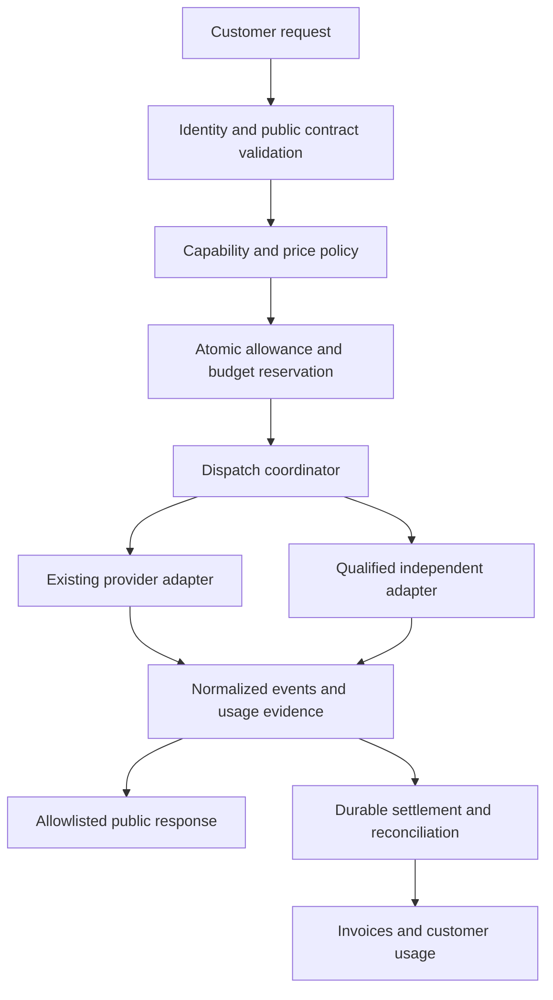

# Broader expansion roadmap and current Sites milestone

**Current selected milestone: bounded fixed-price Sites generation through the existing relay, with durable receipts and customer-owned delivery.** [ADRs 0134–0136](../../docs/adr/README.md) and [Sites operations](../../docs/maintainers/SITES_OPERATIONS.md) define that implemented path. Exact supplier quota/usage and a second provider are not its prerequisites.

## Separate broader expansion proposal

The two-provider and general inference work below remains a proposed expansion roadmap; it is not the release checklist for fixed-price Sites. The [commercial reset execution plan](commercial-reset/EXECUTION.md) controls business priorities and funding; commercial discovery does not have to wait for the second provider. This plan proposes implementation work; none of the runtime changes below has been made by the audit. Roles indicate responsibility to assign, not people already committed. Effort ranges are planning estimates in engineer-days, excluding procurement, customer discovery and observation windows; they are not a delivery commitment.

## Architecture decision

Keep one deployable service initially. Introduce small internal boundaries around the existing flow:

This diagram is internal. Externally document the request contract, capability behavior, rates and customer controls. Do not expose candidate selection, provider routing details, internal budgets, credential sources or execution identifiers.

The provider interface should cover request validation, maximum-cost estimation, execution, normalized events, usage extraction, error classification and cancellation. A result normalizer must preserve supported tool calls, refusals and structured outputs. A provider-specific extension is acceptable when declared; silently ignoring a required feature is not. Separate the public capability descriptor from private adapter configuration using an explicit projection, not a type-level omission over an internal object.

Use versioned records for the public capability/price contract, internal qualified candidates, subscriber entitlements, credit grants, request reservations and attempt/settlement events. These are conceptual entities, not proposed SQL. Schema/RLS design, migration review, rollback and isolated database verification belong to the implementation change under the repository's database governance instructions.

Keep the authoritative admission decision in the existing database for the first version, with atomic reservations. Do not introduce a new distributed counter store merely to copy a gateway architecture. Profile contention using realistic customer/concurrency distributions. If needed later, move to bounded allocation of spending capacity with fenced ownership and explicit failure semantics; a stale cache must never manufacture spendable balance.

## Financial invariants

1. Every paid operation has one tenant-scoped logical request identity, a payload hash and a price-version snapshot. Reusing a key with a changed payload returns a conflict. Do not retain raw customer prompts solely to support financial deduplication.
2. Admission reserves a defensible maximum across included allowance, permitted promotional grants and purchased credit/authorized overage. Request limits enforce the assumptions behind that maximum. Organization, project, key and user ceilings must all permit the reservation.
3. Reserve before dispatch, including queued work at the point where financial responsibility begins. If queued reservations expire, reauthorize before execution. A waiting task cannot bypass a later revoked entitlement or lower budget.
4. Consumption order is explicit: included grants nearing expiry, then permitted promotional grants, then purchased credit; postpaid overage requires an active agreement. Preserve grant provenance and expiration independently.
5. Every supplier attempt records outcome and cost evidence separately from the customer charge. A retry, disconnect, refusal, failed stream or unknown outcome still has a financial state. Supplier expense and customer billable usage are not interchangeable.
6. Settle once per logical request with durable idempotency. Re-delivery may occur; duplicate financial effect must not. An upstream without idempotency/retrieval support cannot provide a cross-system exactly-once execution guarantee.
7. Unknown outcomes enter reconciliation with bounded exposure; they are not automatically released as free or replayed as new work. Deadlines, hold extensions and recovery fencing must agree.
8. A fallback inside an accepted quote does not raise the customer's rate. Candidate supplier cost must fit an internal exposure limit. Price increases require new authorization.
9. Actual usage replaces reservations, with unused amounts released. A charge exceeding the admitted bound is an incident to reconcile, not permission to exceed a customer cap. Define how partial usage is charged and display that policy.
10. Collection failure, refund, dispute, cancellation and downgrade have explicit prospective entitlement effects. Never mutate historical usage or delete financial evidence to repair a balance.

## Work packages

| Ticket | Deliverable and scope | Depends on | Owner | Estimate | Acceptance |
| --- | --- | --- | --- | --- | --- |
| S01 | Baseline and supplier-cost evidence: reconcile request/attempt outcomes, customer collections, credit redemption and supplier invoices; record absent data | None | Backend + finance/product | 2–4 days, then observation | Daily unmatched usage/cost report; no invented COGS; customer/policy segmentation recorded |
| S02 | Chat public DTOs and header allowlists across JSON, SSE, errors, async and compatibility routes | None | API/security | 2–4 days | Adversarial unknown fields disappear; tools/schema/refusals survive; ordinary users cannot read diagnostics |
| S03 | Request-scoped reservations, durable charge events and reconciliation; remove volatile financial effects | S01 data contract | Backend/billing | 6–10 days | Concurrency, process-kill, duplicate-delivery, settlement outage and cancellation matrix passes |
| S04 | One catalog/entitlement/price authority; strict aliases; distinguish exact models and capabilities | S01 | API/product | 3–5 days | One generated public rate/feature contract; unknown model rejected; no identity mismatch |
| S05 | Validated recurring service entitlement, existing grant preservation, separately funded usage and explicit spend controls; no new recurring compute allowance by default | S03, S04 and commercial validation | Billing/product | 5–8 days | Renewals, failed payments, cancellation, refunds, period transitions and cap races pass |
| S06 | Native second-provider adapter plus synthetic conformance fixtures; preserve existing adapter behavior | S02, S04 | API | 3–6 days per candidate | Tools, structured output, usage, errors, timeouts and cancellation meet declared matrix |
| S07 | Supplier qualification and total-cost comparison: direct candidates versus one managed gateway | S01 scope | Product/operations | 2–3 days of analysis; external lead time unknown | Documented commercial access, privacy terms, quota, pricing and support; no assumed independence |
| S08 | Dispatch coordinator with eligibility, common deadlines, attempt limits, backup expense limits and kill switch | S03, S06, S07 | Reliability/API | 4–7 days | Forced failure recovers eligible requests within contract; ineligible requests fail safely |
| S09 | Capability SLOs, quality evaluation and request-to-invoice reconciliation dashboards | S01, S03 | Reliability/product | 3–5 days | Account/policy-specific outcomes visible privately; no raw prompts in default telemetry |
| S10 | Limited pilot, paid-cohort economics and customer comprehension review | S02–S09 | Product + operations | At least one billing cycle | Launch gate below passes; documented continue/change/stop decision |

S02 is the smallest independent code change to start. S03 is the critical path for paid expansion. Supplier research and a synthetic adapter evaluation can proceed while accounting is implemented. For one engineer, expect several weeks of engineering plus a billing-cycle pilot; adding the rows is more honest than compressing them into an unsupported two-week promise. A second engineer can own S06/S07 without duplicating billing work.

## Release sequence

**Stage 0 — Stabilize contracts and measurement.** Ship S02 as a bounded change. Define S01's evidence schema and obtain authorized, aggregated usage and supplier-cost data. Finish S03 and S04 before routing paid requests to an additional supplier. Retain the existing customer experience throughout, except for security/correctness fixes and clearly communicated contract corrections.

**Stage 1 — Qualify an alternative privately.** Use synthetic fixtures and approved evaluation data, not silent replay of customer prompts. Evaluate a small coding/tool and structured-output suite against both candidates. Pin model versions where possible, define semantic tolerances and document unsupported features. Confirm the alternate does not depend on the same restricted account, model provider or required infrastructure for the failures it is meant to cover.

**Stage 2 — Enable a small opted-in cohort.** Start with named test accounts, then an explicitly enrolled group. A proposed ramp is 1%, 5%, 25% and wider eligibility, with at least a full representative traffic window at each stage. Traffic percentages apply only to qualified capability-mode requests. Exact-model requests and disallowed data policies remain constrained by their contracts. Do not mistake a low-volume percentage ramp for a meaningful statistical sample.

**Stage 3 — Pilot the validated operating service.** Use the commercial reset's scoped monthly service and separately funded compute. Preserve existing allowances and purchased-credit obligations; do not introduce new recurring compute grants by default. Defer complicated rollover, annual discounts, pooled enterprise commitments and automatic postpaid credit until the basic lifecycle is reconciled. Existing customers retain recorded commercial terms. Observe renewal and budget-exhaustion behavior before expanding plan complexity.

Include tax treatment and required registrations in the billing release review for the supported markets; a subscription implementation is not complete merely because Checkout collects a payment.

**Stage 4 — Expand only on evidence.** Add another supplier, modality or plan only when it closes a documented paid-demand or reliability gap, has a named owner, passes the same conformance suite and improves expected contribution after maintenance. Dedicated capacity or a managed gateway should have its own procurement decision based on real utilization and contract terms.

## Acceptance matrix

| Area | Adversarial scenario | Required outcome |
| --- | --- | --- |
| Budget admission | 100 simultaneous requests against the last affordable request | Accepted holds never exceed authorized funds or applicable ceilings |
| Idempotency | Same tenant/key/body retried across instances and restarts | Same logical request; no duplicate charge; retained outcome or explicit pending status |
| Idempotency | Same key with changed model, tools, prompt or price-affecting fields | Conflict before any additional dispatch |
| Tenant authority | Another user guesses request ID; ordinary bearer calls operations routes | No disclosure/mutation; diagnostics require server-side administrator authorization |
| Lifecycle | Duplicate/out-of-order payment or renewal events | Exactly one period grant; correct effective state; reconciliation can repair missing events |
| Cap changes | Owner lowers cap while requests are queued or in flight | No new admission above new limit; in-flight reserved liability accounted for explicitly |
| Streaming usage | Identical content split at every byte, UTF-8 boundary and SSE delimiter | Identical usage and charge; provider-reported totals preserved |
| Streaming failure | Partial response, abrupt EOF, malformed usage, cancellation | Truthful completion state; usage/cost reconciliation; no silent replacement stream |
| Durability | Process stops after dispatch or before/after settlement acknowledgement | Recoverable request and hold; no forgotten liability or duplicate financial effect |
| Fallback | Primary 429/503 before execution, backup eligible and affordable | One bounded alternate attempt within the same quote and remaining deadline |
| Fallback | Invalid schema, auth error, cancellation, safety refusal | No arbitrary cross-provider retry; contract-appropriate response |
| Side effects | Image/tool execution accepted, acknowledgement lost | Retrieve/reconcile if supported; never blindly execute a second time |
| Capability | Backup lacks strict schema, tool mode, context or modality | Excluded before dispatch; feature is never silently dropped |
| Privacy | Only backup violates tenant retention or location requirements | Fail closed; preserve the policy |
| Public JSON/SSE | Additional nested provider/diagnostic fields and unsafe error bodies | Only allowlisted public fields; no wholesale object/header forwarding |
| Tools/async | Completed tool call returned through every compatible endpoint | Call IDs, function name/arguments, completion state and allowed usage preserved |
| Images | Metadata-bearing upstream image; raw HTTP and async/download variants | Re-encoded artifact; no upstream metadata; exact JSON contract when requested |
| Shared outage | Database unavailable, stale budget cache, primary unavailable | No financial fail-open; bounded recovery; unaffected reads stay available where safe |
| Artifact retrieval | Request completes then serving process restarts | Authorized artifact remains retrievable for the promised period |
| Fairness | One tenant runs long parallel agent loops | Organization/project limits and capacity isolation protect other customers |

Use disposable databases and synthetic suppliers for destructive and concurrent tests. This report adds no SQL and does not authorize treating broad integration scripts as safe against production. The implementation must follow the existing migration, rollback and tenant-authorization process.

## Pilot gate

The following are proposed targets, not measured performance or an advertised SLA:

- Zero known P1 public-boundary or financial correctness failures in the scoped matrix; unresolved unknown outcomes are visible and within a predefined exposure budget.
- Every admitted paid request maps to a durable reservation and a terminal or reconciling state. Internal event totals reconcile exactly; supplier invoice differences use a documented timing/rounding tolerance and an exception queue.
- No customer charge above the authorized ceiling in adversarial tests; no duplicate period grant or logical-request charge.
- Start with a 99.9% completed-request SLO over a rolling 30-day window for each supported capability, subject to validating feasibility before advertising it. Track partial streams and rejected eligible requests; state exclusions before collecting results.
- Compare first meaningful output and completion latency with the existing baseline. A provisional rollback trigger is a sustained 20% p95 regression or an error-budget burn requiring a release freeze; choose absolute customer deadlines before pilot.
- A forced-primary-failure exercise succeeds for the published eligible subset. Record unqualified requests separately; do not inflate success by excluding them after the fact.
- Positive cohort contribution after actual usage, refunds, payment fees, infrastructure and support. The commercial reset targets 75% contribution on the operating service, with compute and outage funding assessed separately; it supersedes the original bundled-package 50% target. Neither is a universal industry margin.
- At least one renewal, exhaustion, cancellation and failed-payment scenario is verified before general release. Customer comprehension testing confirms users can distinguish service scope, separately funded compute, existing grants and what enables extra charges.

## Rollback and operational ownership

Keep new provider and commercial features independently switchable. On routing rollback, stop admitting new alternate executions and let accepted work complete or reconcile; preserve artifacts and financial events. Do not change a customer's selected model to the primary if that violates their contract. On billing trouble, disable new overage admission while preserving purchased credit and historical grants; reconcile before resuming.

For additive financial schema changes, prefer disabling new writers/read paths over a destructive down migration after financial events exist. A reviewed rollback must preserve ledger history and existing customer balances. Feature-flag rollback does not remove already incurred supplier liabilities.

Assign an on-call owner before expanding traffic. The incident view should include failure category, capacity, expense, reconciliation age and active policy version behind administrator authorization. Public status should describe affected capabilities and customer impact. The new adapter must include upgrade/deprecation review, a canary schedule and an exit procedure so its long-term cost is visible.
